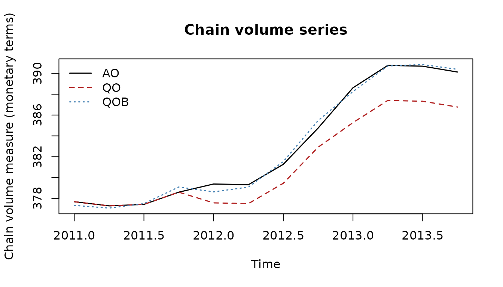
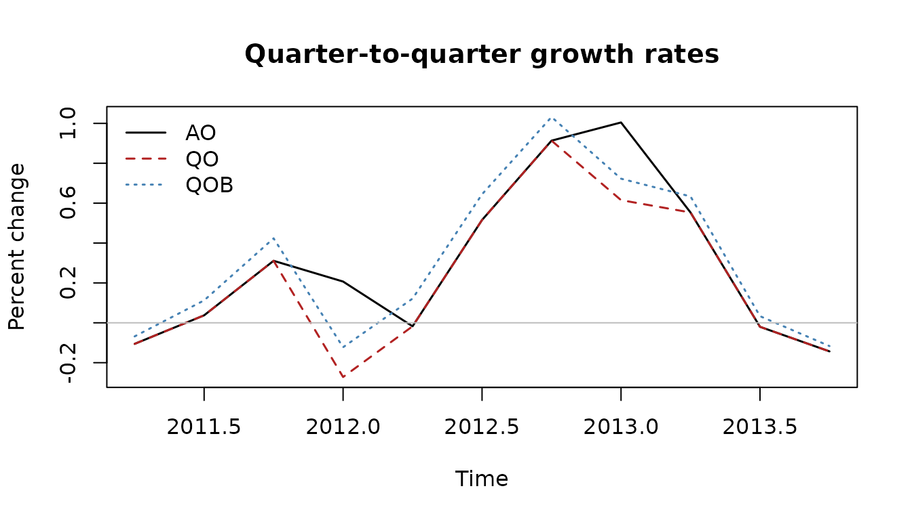
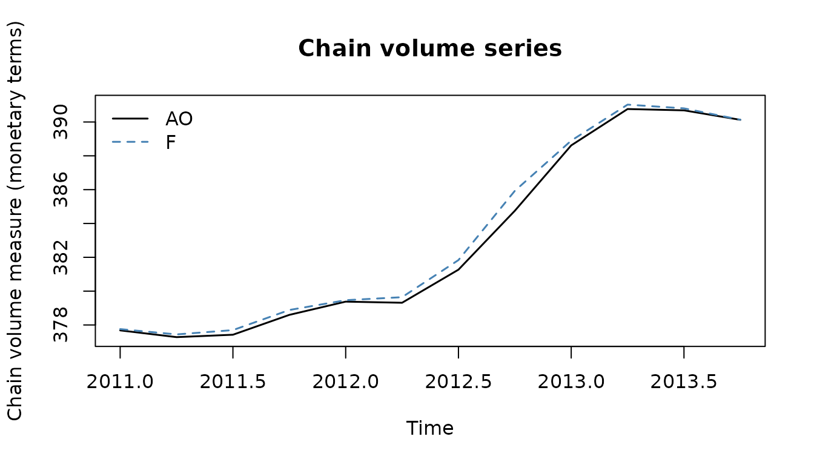
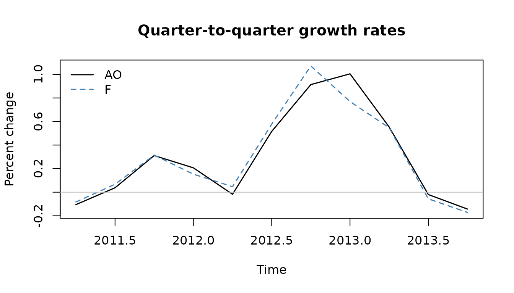

# Chapter 8 of the IMF Quarterly National Accounts Manual

``` r

library(chainlink)
# The benchmarking examples use the suggested package tempdisagg
has_tempdisagg <- requireNamespace("tempdisagg", quietly = TRUE)
# Percent change over the previous period
growth_rate <- function(x) 100 * (x / stats::lag(x, -1) - 1)
```

## Correspondence between the manual and the package

This vignette reproduces the examples of chapter 8 (price and volume
measures) of the IMF [*Quarterly National Accounts
Manual*](https://doi.org/10.5089/9781475589870.069) with the functions
of the package. The table gives the function(s) used for each example.
The paragraph numbers are those of the 2017 edition.

| Manual | Paragraphs | Topic | Function(s) |
|----|----|----|----|
| Example 8.1 | 8.24-8.26 | Weighted and unweighted annual averages of prices | base R |
| Example 8.2 | 8.35-8.39 | Annual and quarterly volume measures, Laspeyres-type | [`cp_pi2vol()`](https://aqlt.github.io/chainlink/reference/cp_pi2vol.md), [`laspeyres()`](https://aqlt.github.io/chainlink/reference/fixed_weight_indices.md) |
| Example 8.3 | 8.40-8.46 | Annual volume measures, Fisher | [`pi_annual()`](https://aqlt.github.io/chainlink/reference/pi_annual.md), [`laspeyres()`](https://aqlt.github.io/chainlink/reference/fixed_weight_indices.md), [`paasche()`](https://aqlt.github.io/chainlink/reference/fixed_weight_indices.md), [`fisher()`](https://aqlt.github.io/chainlink/reference/fixed_weight_indices.md) on annual data |
| Example 8.4 | 8.44-8.46 | Quarterly volume measures, Fisher | [`pi_py2pp()`](https://aqlt.github.io/chainlink/reference/pi_py2pp.md), `fisher(reference_freq = 4)` |
| Example 8.5 | 8.59-8.60 | Frequency of chain-linking and drift | [`laspeyres()`](https://aqlt.github.io/chainlink/reference/fixed_weight_indices.md), [`paasche()`](https://aqlt.github.io/chainlink/reference/fixed_weight_indices.md), [`fisher()`](https://aqlt.github.io/chainlink/reference/fixed_weight_indices.md) with `reference_freq = 4` |
| Example 8.6 | 8.71 | Annual overlap | `chain_link(method = "ao")`, [`annual_chain()`](https://aqlt.github.io/chainlink/reference/chain_link.md) |
| Example 8.7 | 8.72 | One-quarter overlap | `chain_laspeyres(method = "oqo", overlap_prices = "current_prices")`, [`chain_discrepancy()`](https://aqlt.github.io/chainlink/reference/chain_discrepancy.md), [`cp_pi2cy()`](https://aqlt.github.io/chainlink/reference/cp_pi2cy.md) |
| Example 8.8 | 8.46, 8.74-8.76 | Chain-linking and benchmarking of quarterly Fisher indices | `fisher(reference_freq = 4)`, [`annual_chain()`](https://aqlt.github.io/chainlink/reference/chain_link.md), [`tempdisagg::td()`](http://cynkra.github.io/tempdisagg/reference/td.md) (suggested) |
| Example 8.9 | 8.85-8.88 | Contributions to percent change, annually chained Laspeyres-type | `chain_contrib(method = "ao")` |
|  | 8.89 | Contributions to percent change, quarterly Fisher | [`fisher_contrib()`](https://aqlt.github.io/chainlink/reference/fisher_contrib.md) |
|  | 8.90 | Contributions of variables of any sign (inventories) | residually, see [`?chain_contrib`](https://aqlt.github.io/chainlink/reference/chain_contrib.md) |
|  | 8.56-8.58 | Pseudo chain volume series of variables that change sign | [`chain_pseudo()`](https://aqlt.github.io/chainlink/reference/chain_pseudo.md) |
| Figures 8.1, 8.2 | 8.72, 8.74 (examples 8.7, 8.8) | AO vs OQO, Laspeyres vs Fisher | [`chain_link()`](https://aqlt.github.io/chainlink/reference/chain_link.md), [`tempdisagg::td()`](http://cynkra.github.io/tempdisagg/reference/td.md) (suggested) |
| Example 8.A1, Figure 8.A1 | 8.73, annex 8.1 | AO, OQO and OQO with benchmarking | [`chain_link()`](https://aqlt.github.io/chainlink/reference/chain_link.md), [`tempdisagg::td()`](http://cynkra.github.io/tempdisagg/reference/td.md) (suggested) |

Additions to the manual:

| Function | Purpose |
|----|----|
| [`pi_py2pp()`](https://aqlt.github.io/chainlink/reference/pi_py2pp.md) | Price indices over the previous year converted to price indices over the previous period (needed for quarterly or monthly Fisher indices) |
| [`pi_annual()`](https://aqlt.github.io/chainlink/reference/pi_annual.md) | Annual price indices from quarterly or monthly ones (weighted or simple averages) |
| [`chain_laspeyres()`](https://aqlt.github.io/chainlink/reference/chain_laspeyres.md) | Chain-linked volume indices or measures of the components and of the total in one step |
| [`cp_pi2cy()`](https://aqlt.github.io/chainlink/reference/cp_pi2cy.md) | Quarterly values at the average prices of the year (overlap quarter of the one-quarter overlap technique) |
| [`chain_discrepancy()`](https://aqlt.github.io/chainlink/reference/chain_discrepancy.md) | Non-additivity of the chain volume measures |
| [`chain_rebase()`](https://aqlt.github.io/chainlink/reference/chain_rebase.md) | Change of the reference year |
| [`chain_pseudo()`](https://aqlt.github.io/chainlink/reference/chain_pseudo.md) | Pseudo chain volume series of a variable that changes sign |
| `chain_contrib(method = "oqo")` | Exactly additive contributions for the one-quarter overlap technique |
| `chain_contrib(type = "annual")` | Contributions to the growth of the annual sums |
| `chain_contrib(extra = )` | Growth of the total and non-additivity residual |

The contributions are detailed in the vignette `contributions`: the
formulas for the annual overlap are the equations (29) to (31) of the
manual, those for the one-quarter overlap are derived from the same
decomposition, and all of them are checked on fully consistent data, for
which contributions add up exactly to the growth of the total.

## Weighted and Unweighted Annual Averages of Prices When Sales and Price Patterns Through the Year are Uneven (example 8.1)

A single homogeneous product is sold only in the second and third
quarters: the quantities are the same in 1999 and 2000, but the sales
shift towards the second quarter. The annual price must be the average
of the quarterly prices weighted by the quantities (the unit value), not
the simple average.

``` r

ex8.1 <- data.frame(
    year = rep(c(1999, 2000), each = 4),
    quarter = rep(paste0("q", 1:4), 2),
    quantity = c(0, 150, 50, 0, 0, 180, 20, 0),
    price = c(80, 50, 30, 40, 40, 50, 30, 40)
)
# (3) Current price value
ex8.1$value <- ex8.1$quantity * ex8.1$price

annual8.1 <- data.frame(
    year = c(1999, 2000),
    quantity = tapply(ex8.1$quantity, ex8.1$year, sum),
    value = tapply(ex8.1$value, ex8.1$year, sum),
    # (4) Unweighted average price
    unweighted_price = tapply(ex8.1$price, ex8.1$year, mean)
)
# (5) Unit value weighted average price
annual8.1$weighted_price <- annual8.1$value / annual8.1$quantity
annual8.1
#>      year quantity value unweighted_price weighted_price
#> 1999 1999      200  9000               50             45
#> 2000 2000      200  9600               40             48
```

Quarterly constant price values, with the 1999 average prices:

``` r

unweighted_1999 <- annual8.1$unweighted_price[1]
weighted_1999 <- annual8.1$weighted_price[1]
# (6) At unweighted average 1999 prices and (7) at weighted average 1999 prices
ex8.1$constant_unweighted <- ex8.1$quantity * unweighted_1999
ex8.1$constant_weighted <- ex8.1$quantity * weighted_1999
ex8.1
#>   year quarter quantity price value constant_unweighted constant_weighted
#> 1 1999      q1        0    80     0                   0                 0
#> 2 1999      q2      150    50  7500                7500              6750
#> 3 1999      q3       50    30  1500                2500              2250
#> 4 1999      q4        0    40     0                   0                 0
#> 5 2000      q1        0    40     0                   0                 0
#> 6 2000      q2      180    50  9000                9000              8100
#> 7 2000      q3       20    30   600                1000               900
#> 8 2000      q4        0    40     0                   0                 0

annual8.1$constant_unweighted <- tapply(ex8.1$constant_unweighted, ex8.1$year, sum)
annual8.1$constant_weighted <- tapply(ex8.1$constant_weighted, ex8.1$year, sum)
annual8.1[, c("year", "value", "constant_unweighted", "constant_weighted")]
#>      year value constant_unweighted constant_weighted
#> 1999 1999  9000               10000              9000
#> 2000 2000  9600               10000              9000
```

Percent changes from 1999 to 2000:

``` r

pct <- function(x) round(100 * (x[2] / x[1] - 1), 1)
c(`current price value` = pct(annual8.1$value),
  `unweighted average price` = pct(annual8.1$unweighted_price),
  `weighted average price` = pct(annual8.1$weighted_price),
  `volume (weighted average prices)` = pct(annual8.1$constant_weighted),
  # direct deflation with the unweighted price: misleading
  `volume (direct deflation, unweighted prices)` =
    pct(annual8.1$value / annual8.1$unweighted_price))
#>                          current price value 
#>                                          6.7 
#>                     unweighted average price 
#>                                        -20.0 
#>                       weighted average price 
#>                                          6.7 
#>             volume (weighted average prices) 
#>                                          0.0 
#> volume (direct deflation, unweighted prices) 
#>                                         33.3
```

The unweighted average price falls by 20%, so deflating the annual
current price data with it wrongly gives a volume increase of 33.3%.
With the weighted average price, the volume is stable, as the
quantities. The annual sum of the quarterly constant price values at the
unweighted average price of the base year (column 6) differs from the
current price value (10000 instead of 9000): it can be corrected by a
multiplicative adjustment (9000/10000) of the whole series, which does
not change the rates of change.

## Deriving Annual and Quarterly Volume Measures using Laspeyres-type Formula (example 8.2)

Elementary Volume Measures (in monetary terms)

``` r

evm <- imf_cp / imf_pi * 100
evm |> round(1)
#>         imf_cp.A imf_cp.B
#> 2010 Q1       NA       NA
#> 2010 Q2       NA       NA
#> 2010 Q3       NA       NA
#> 2010 Q4       NA       NA
#> 2011 Q1    156.6    221.1
#> 2011 Q2    159.2    218.1
#> 2011 Q3    162.5    214.9
#> 2011 Q4    164.8    213.8
#> 2012 Q1    170.0    210.4
#> 2012 Q2    176.9    203.4
#> 2012 Q3    187.0    195.2
#> 2012 Q4    212.3    173.4
#> 2013 Q1    223.6    166.0
#> 2013 Q2    237.0    154.8
#> 2013 Q3    245.4    146.3
#> 2013 Q4    249.1    142.0
```

Elementary Volume Indices (previous year = 100)

``` r

cp_pi2vol(imf_cp, imf_pi) |> round(1)
#>             A    B
#> 2011 Q1 104.4 98.3
#> 2011 Q2 106.1 96.9
#> 2011 Q3 108.3 95.5
#> 2011 Q4 109.8 95.0
#> 2012 Q1 103.0 98.5
#> 2012 Q2 107.2 95.2
#> 2012 Q3 113.4 91.3
#> 2012 Q4 128.7 81.1
#> 2013 Q1 117.8 86.3
#> 2013 Q2 124.9 80.4
#> 2013 Q3 129.3 76.1
#> 2013 Q4 131.3 73.8
```

Laspeyres Volume Index (previous year = 100)

``` r

laspeyres(imf_cp, imf_pi, output = "index") |> round(1)
#>       Qtr1  Qtr2  Qtr3  Qtr4
#> 2011 100.7 100.6 100.6 101.0
#> 2012 100.4 100.4 100.9 101.9
#> 2013 102.0 102.5 102.5 102.3
```

Laspeyres Volume Measure (in monetary terms)

``` r

laspeyres(imf_cp, imf_pi, output = "measure") |> round(1)
#>       Qtr1  Qtr2  Qtr3  Qtr4
#> 2011 377.7 377.3 377.4 378.6
#> 2012 380.4 380.3 382.3 385.7
#> 2013 389.6 391.7 391.7 391.1
```

Laspeyres Volume Index (previous year = 100) and Measure (in monetary
terms)

``` r

laspeyres(imf_cp, imf_pi, output = "both") |> round(1)
#>         Index Measure
#> 2011 Q1 100.7   377.7
#> 2011 Q2 100.6   377.3
#> 2011 Q3 100.6   377.4
#> 2011 Q4 101.0   378.6
#> 2012 Q1 100.4   380.4
#> 2012 Q2 100.4   380.3
#> 2012 Q3 100.9   382.3
#> 2012 Q4 101.9   385.7
#> 2013 Q1 102.0   389.6
#> 2013 Q2 102.5   391.7
#> 2013 Q3 102.5   391.7
#> 2013 Q4 102.3   391.1
```

Summary table :

``` r

table_8.2 <- 
    ts.union(
        imf_cp,
        imf_cp[,"A"] +  imf_cp[,"B"],
        imf_pi,
        evm,
        evm[,1] + evm[,2],
        cp_pi2vol(imf_cp, imf_pi),
        laspeyres(imf_cp, imf_pi, output = "index"),
        laspeyres(imf_cp, imf_pi, output = "measure")
    )
colnames(table_8.2) <- c(
    paste("Current Prices", c("A", "B", "Total")),
    paste("Elementary Price Indices", c("A", "B")),
    paste("Elementary Volume Measures", c("A", "B", "Sum")),
    paste("Elementary Volume Indices", c("A", "B")),
    "Laspeyres Volume Index",
    "Laspeyres Volume Measures"
)
round(table_8.2, 2)
#>         Current Prices A Current Prices B Current Prices Total
#> 2010 Q1            150.0            225.0                375.0
#> 2010 Q2            150.0            225.0                375.0
#> 2010 Q3            150.0            225.0                375.0
#> 2010 Q4            150.0            225.0                375.0
#> 2011 Q1            159.7            218.9                378.6
#> 2011 Q2            163.2            213.7                376.9
#> 2011 Q3            167.4            210.6                378.0
#> 2011 Q4            169.7            211.7                381.4
#> 2012 Q1            174.2            204.1                378.3
#> 2012 Q2            180.4            201.4                381.8
#> 2012 Q3            188.9            192.3                381.2
#> 2012 Q4            215.5            171.7                387.2
#> 2013 Q1            224.7            166.0                390.7
#> 2013 Q2            235.8            156.3                392.1
#> 2013 Q3            242.9            148.5                391.4
#> 2013 Q4            245.4            144.8                390.2
#>         Elementary Price Indices A Elementary Price Indices B
#> 2010 Q1                         NA                         NA
#> 2010 Q2                         NA                         NA
#> 2010 Q3                         NA                         NA
#> 2010 Q4                         NA                         NA
#> 2011 Q1                      102.0                       99.0
#> 2011 Q2                      102.5                       98.0
#> 2011 Q3                      103.0                       98.0
#> 2011 Q4                      103.0                       99.0
#> 2012 Q1                      102.5                       97.0
#> 2012 Q2                      102.0                       99.0
#> 2012 Q3                      101.0                       98.5
#> 2012 Q4                      101.5                       99.0
#> 2013 Q1                      100.5                      100.0
#> 2013 Q2                       99.5                      101.0
#> 2013 Q3                       99.0                      101.5
#> 2013 Q4                       98.5                      102.0
#>         Elementary Volume Measures A Elementary Volume Measures B
#> 2010 Q1                           NA                           NA
#> 2010 Q2                           NA                           NA
#> 2010 Q3                           NA                           NA
#> 2010 Q4                           NA                           NA
#> 2011 Q1                       156.57                       221.11
#> 2011 Q2                       159.22                       218.06
#> 2011 Q3                       162.52                       214.90
#> 2011 Q4                       164.76                       213.84
#> 2012 Q1                       169.95                       210.41
#> 2012 Q2                       176.86                       203.43
#> 2012 Q3                       187.03                       195.23
#> 2012 Q4                       212.32                       173.43
#> 2013 Q1                       223.58                       166.00
#> 2013 Q2                       236.98                       154.75
#> 2013 Q3                       245.35                       146.31
#> 2013 Q4                       249.14                       141.96
#>         Elementary Volume Measures Sum Elementary Volume Indices A
#> 2010 Q1                             NA                          NA
#> 2010 Q2                             NA                          NA
#> 2010 Q3                             NA                          NA
#> 2010 Q4                             NA                          NA
#> 2011 Q1                         377.68                      104.38
#> 2011 Q2                         377.28                      106.15
#> 2011 Q3                         377.42                      108.35
#> 2011 Q4                         378.60                      109.84
#> 2012 Q1                         380.36                      103.00
#> 2012 Q2                         380.30                      107.19
#> 2012 Q3                         382.26                      113.35
#> 2012 Q4                         385.75                      128.68
#> 2013 Q1                         389.58                      117.83
#> 2013 Q2                         391.74                      124.89
#> 2013 Q3                         391.66                      129.30
#> 2013 Q4                         391.10                      131.30
#>         Elementary Volume Indices B Laspeyres Volume Index
#> 2010 Q1                          NA                     NA
#> 2010 Q2                          NA                     NA
#> 2010 Q3                          NA                     NA
#> 2010 Q4                          NA                     NA
#> 2011 Q1                       98.27                 100.71
#> 2011 Q2                       96.92                 100.61
#> 2011 Q3                       95.51                 100.65
#> 2011 Q4                       95.04                 100.96
#> 2012 Q1                       98.45                 100.43
#> 2012 Q2                       95.19                 100.42
#> 2012 Q3                       91.35                 100.93
#> 2012 Q4                       81.15                 101.85
#> 2013 Q1                       86.29                 101.95
#> 2013 Q2                       80.44                 102.52
#> 2013 Q3                       76.05                 102.49
#> 2013 Q4                       73.79                 102.35
#>         Laspeyres Volume Measures
#> 2010 Q1                        NA
#> 2010 Q2                        NA
#> 2010 Q3                        NA
#> 2010 Q4                        NA
#> 2011 Q1                    377.68
#> 2011 Q2                    377.28
#> 2011 Q3                    377.42
#> 2011 Q4                    378.60
#> 2012 Q1                    380.36
#> 2012 Q2                    380.30
#> 2012 Q3                    382.26
#> 2012 Q4                    385.75
#> 2013 Q1                    389.58
#> 2013 Q2                    391.74
#> 2013 Q3                    391.66
#> 2013 Q4                    391.10
```

## Deriving Annual Volume Measures using Fisher Formula (example 8.3)

The annual data are derived from the quarterly data of example 8.2. As
in the manual, the annual price indices are the weighted averages of the
quarterly ones
([`pi_annual()`](https://aqlt.github.io/chainlink/reference/pi_annual.md),
as the unit value of example 8.1): the annual volumes at the prices of
the previous year are then the annual sums of the quarterly ones, which
is not the case with the simple averages (`method = "mean"`).

Annual Elementary Price Indices (weighted and simple averages)

``` r

imf_cp_an <- stats::aggregate.ts(imf_cp)
imf_pi_an <- pi_annual(imf_pi, imf_cp)
ts.union(Weighted = imf_pi_an,
         Simple = pi_annual(imf_pi, method = "mean")) |> round(2)
#> Time Series:
#> Start = 2010 
#> End = 2013 
#> Frequency = 1 
#>      Weighted.A Weighted.B Simple.A Simple.B
#> 2010         NA         NA       NA       NA
#> 2011     102.63      98.50   102.62    98.50
#> 2012     101.72      98.34   101.75    98.38
#> 2013      99.34     101.08    99.38   101.12
```

Elementary Level Deflation

``` r

eld <- imf_cp_an / imf_pi_an * 100 
eld |> round(1)
#> Time Series:
#> Start = 2010 
#> End = 2013 
#> Frequency = 1 
#>      imf_cp_an.A imf_cp_an.B
#> 2010          NA          NA
#> 2011       643.1       867.9
#> 2012       746.2       782.5
#> 2013       955.1       609.0
```

Elementary Volume Indices (year-on-year)

``` r

cp_pi2vol(imf_cp_an, imf_pi_an) |> round(2)
#> Time Series:
#> Start = 2011 
#> End = 2013 
#> Frequency = 1 
#>           A     B
#> 2011 107.18 96.43
#> 2012 113.05 91.53
#> 2013 125.83 79.14
```

Laspeyres Volume Index (previous year = 100)

``` r

laspeyres(imf_cp_an, imf_pi_an, output = "index") |> round(2)
#> Time Series:
#> Start = 2011 
#> End = 2013 
#> Frequency = 1 
#> [1] 100.73 100.91 102.33
```

Paasche Volume Measure (previous year = 100)

``` r

paasche(imf_cp_an, imf_pi_an, output = "index") |> round(2)
#> Time Series:
#> Start = 2011 
#> End = 2013 
#> Frequency = 1 
#> [1] 100.84 101.09 102.13
```

Fisher Volume Measure (previous year = 100)

``` r

fisher(imf_cp_an, imf_pi_an, output = "index") |> round(2)
#> Time Series:
#> Start = 2011 
#> End = 2013 
#> Frequency = 1 
#> [1] 100.79 101.00 102.23
```

Summary Table

``` r

table_8.3 <- 
    ts.union(
        imf_cp_an,
        imf_cp_an[,"A"] +  imf_cp_an[,"B"],
        imf_pi_an,
        imf_cp_an / imf_pi_an * 100,
        cp_pi2vol(imf_cp_an, imf_pi_an),
        laspeyres(imf_cp_an, imf_pi_an, output = "index"),
        paasche(imf_cp_an, imf_pi_an, output = "index"),
        fisher(imf_cp_an, imf_pi_an, output = "index")
    )
colnames(table_8.3) <- c(
    paste("Current Prices", c("A", "B", "Total")),
    paste("Elementary Price Indices", c("A", "B")),
    paste("Elementary Level Deflation", c("A", "B")),
    paste("Elementary Volume Indices", c("A", "B")),
    "Laspeyres Volume Index",
    "Paasche Volume Index",
    "Fisher Volume Index"
)
round(table_8.3, 2)
#> Time Series:
#> Start = 2010 
#> End = 2013 
#> Frequency = 1 
#>      Current Prices A Current Prices B Current Prices Total
#> 2010            600.0            900.0               1500.0
#> 2011            660.0            854.9               1514.9
#> 2012            759.0            769.5               1528.5
#> 2013            948.8            615.6               1564.4
#>      Elementary Price Indices A Elementary Price Indices B
#> 2010                         NA                         NA
#> 2011                     102.63                      98.50
#> 2012                     101.72                      98.34
#> 2013                      99.34                     101.08
#>      Elementary Level Deflation A Elementary Level Deflation B
#> 2010                           NA                           NA
#> 2011                       643.07                       867.91
#> 2012                       746.16                       782.51
#> 2013                       955.06                       609.02
#>      Elementary Volume Indices A Elementary Volume Indices B
#> 2010                          NA                          NA
#> 2011                      107.18                       96.43
#> 2012                      113.05                       91.53
#> 2013                      125.83                       79.14
#>      Laspeyres Volume Index Paasche Volume Index Fisher Volume Index
#> 2010                     NA                   NA                  NA
#> 2011                 100.73               100.84              100.79
#> 2012                 100.91               101.09              101.00
#> 2013                 102.33               102.13              102.23
```

## Deriving Quarterly Volume Measures using Fisher Formula (example 8.4)

With `reference_freq = 4`, the volume indices are computed over the
previous quarter: they need price indices over the previous quarter,
whereas those of example 8.2 are over the previous year.
[`pi_py2pp()`](https://aqlt.github.io/chainlink/reference/pi_py2pp.md)
converts them (these are the price indices of example 8.4).

``` r

ep8.4 <- pi_py2pp(imf_pi)
ep8.4 |> round(2)
#>              A      B
#> 2011 Q1 102.00  99.00
#> 2011 Q2 100.49  98.99
#> 2011 Q3 100.49 100.00
#> 2011 Q4 100.00 101.02
#> 2012 Q1 102.13  96.51
#> 2012 Q2  99.51 102.06
#> 2012 Q3  99.02  99.49
#> 2012 Q4 100.50 100.51
#> 2013 Q1 100.75  99.37
#> 2013 Q2  99.00 101.00
#> 2013 Q3  99.50 100.50
#> 2013 Q4  99.49 100.49
```

Elementary Level Deflation

``` r

eld <- imf_cp / ep8.4 * 100
eld |> round(1)
#>         imf_cp.A imf_cp.B
#> 2011 Q1    156.6    221.1
#> 2011 Q2    162.4    215.9
#> 2011 Q3    166.6    210.6
#> 2011 Q4    169.7    209.6
#> 2012 Q1    170.6    211.5
#> 2012 Q2    181.3    197.3
#> 2012 Q3    190.8    193.3
#> 2012 Q4    214.4    170.8
#> 2013 Q1    223.0    167.1
#> 2013 Q2    238.2    154.8
#> 2013 Q3    244.1    147.8
#> 2013 Q4    246.6    144.1
```

Elementary Volume Indices (quarter-to-quarter)

``` r

cp_pi2vol(imf_cp, ep8.4, reference_freq = 4) |> round(2)
#>              A     B
#> 2011 Q1 104.38 98.27
#> 2011 Q2 101.69 98.62
#> 2011 Q3 102.08 98.55
#> 2011 Q4 101.37 99.51
#> 2012 Q1 100.51 99.90
#> 2012 Q2 104.07 96.68
#> 2012 Q3 105.75 95.97
#> 2012 Q4 113.52 88.84
#> 2013 Q1 103.50 97.29
#> 2013 Q2 105.99 93.22
#> 2013 Q3 103.53 94.54
#> 2013 Q4 101.54 97.03
```

Laspeyres Volume Index (previous quarter = 100)

``` r

laspeyres(imf_cp, ep8.4, output = "index", reference_freq = 4) |> round(2)
#>        Qtr1   Qtr2   Qtr3   Qtr4
#> 2011 100.71  99.92 100.08 100.33
#> 2012 100.17 100.08 100.59 101.07
#> 2013 100.75 100.57  99.95  99.83
```

Paasche Volume Measure (previous quarter = 100)

``` r

paasche(imf_cp, ep8.4, output = "index", reference_freq = 4) |> round(2)
#>        Qtr1   Qtr2   Qtr3   Qtr4
#> 2011 100.76  99.93 100.08 100.33
#> 2012 100.18 100.04 100.58 101.07
#> 2013 100.77 100.51  99.93  99.82
```

Fisher Volume Index (previous quarter = 100)

``` r

fisher(imf_cp, ep8.4, output = "index", reference_freq = 4) |> round(2)
#>        Qtr1   Qtr2   Qtr3   Qtr4
#> 2011 100.74  99.92 100.08 100.33
#> 2012 100.18 100.06 100.58 101.07
#> 2013 100.76 100.54  99.94  99.83
```

Summary Table

``` r

table_8.4 <- 
    ts.union(
        imf_cp,
        imf_cp[,"A"] +  imf_cp[,"B"],
        ep8.4,
        eld,
        cp_pi2vol(imf_cp, ep8.4, reference_freq = 4),
        laspeyres(imf_cp, ep8.4, output = "index", reference_freq = 4),
        paasche(imf_cp, ep8.4, output = "index", reference_freq = 4),
        fisher(imf_cp, ep8.4, output = "index", reference_freq = 4)
    )
colnames(table_8.4) <- c(
    paste("Current Prices", c("A", "B", "Total")),
    paste("Elementary Price Indices", c("A", "B")),
    paste("Elementary Level Deflation", c("A", "B")),
    paste("Elementary Volume Indices", c("A", "B")),
    "Laspeyres Volume Index",
    "Paasche Volume Index",
    "Fisher Volume Index"
)
round(table_8.4, 2)
#>         Current Prices A Current Prices B Current Prices Total
#> 2010 Q1            150.0            225.0                375.0
#> 2010 Q2            150.0            225.0                375.0
#> 2010 Q3            150.0            225.0                375.0
#> 2010 Q4            150.0            225.0                375.0
#> 2011 Q1            159.7            218.9                378.6
#> 2011 Q2            163.2            213.7                376.9
#> 2011 Q3            167.4            210.6                378.0
#> 2011 Q4            169.7            211.7                381.4
#> 2012 Q1            174.2            204.1                378.3
#> 2012 Q2            180.4            201.4                381.8
#> 2012 Q3            188.9            192.3                381.2
#> 2012 Q4            215.5            171.7                387.2
#> 2013 Q1            224.7            166.0                390.7
#> 2013 Q2            235.8            156.3                392.1
#> 2013 Q3            242.9            148.5                391.4
#> 2013 Q4            245.4            144.8                390.2
#>         Elementary Price Indices A Elementary Price Indices B
#> 2010 Q1                         NA                         NA
#> 2010 Q2                         NA                         NA
#> 2010 Q3                         NA                         NA
#> 2010 Q4                         NA                         NA
#> 2011 Q1                     102.00                      99.00
#> 2011 Q2                     100.49                      98.99
#> 2011 Q3                     100.49                     100.00
#> 2011 Q4                     100.00                     101.02
#> 2012 Q1                     102.13                      96.51
#> 2012 Q2                      99.51                     102.06
#> 2012 Q3                      99.02                      99.49
#> 2012 Q4                     100.50                     100.51
#> 2013 Q1                     100.75                      99.37
#> 2013 Q2                      99.00                     101.00
#> 2013 Q3                      99.50                     100.50
#> 2013 Q4                      99.49                     100.49
#>         Elementary Level Deflation A Elementary Level Deflation B
#> 2010 Q1                           NA                           NA
#> 2010 Q2                           NA                           NA
#> 2010 Q3                           NA                           NA
#> 2010 Q4                           NA                           NA
#> 2011 Q1                       156.57                       221.11
#> 2011 Q2                       162.40                       215.88
#> 2011 Q3                       166.59                       210.60
#> 2011 Q4                       169.70                       209.56
#> 2012 Q1                       170.57                       211.48
#> 2012 Q2                       181.28                       197.33
#> 2012 Q3                       190.77                       193.28
#> 2012 Q4                       214.44                       170.83
#> 2013 Q1                       223.03                       167.05
#> 2013 Q2                       238.17                       154.75
#> 2013 Q3                       244.13                       147.77
#> 2013 Q4                       246.65                       144.09
#>         Elementary Volume Indices A Elementary Volume Indices B
#> 2010 Q1                          NA                          NA
#> 2010 Q2                          NA                          NA
#> 2010 Q3                          NA                          NA
#> 2010 Q4                          NA                          NA
#> 2011 Q1                      104.38                       98.27
#> 2011 Q2                      101.69                       98.62
#> 2011 Q3                      102.08                       98.55
#> 2011 Q4                      101.37                       99.51
#> 2012 Q1                      100.51                       99.90
#> 2012 Q2                      104.07                       96.68
#> 2012 Q3                      105.75                       95.97
#> 2012 Q4                      113.52                       88.84
#> 2013 Q1                      103.50                       97.29
#> 2013 Q2                      105.99                       93.22
#> 2013 Q3                      103.53                       94.54
#> 2013 Q4                      101.54                       97.03
#>         Laspeyres Volume Index Paasche Volume Index Fisher Volume Index
#> 2010 Q1                     NA                   NA                  NA
#> 2010 Q2                     NA                   NA                  NA
#> 2010 Q3                     NA                   NA                  NA
#> 2010 Q4                     NA                   NA                  NA
#> 2011 Q1                 100.71               100.76              100.74
#> 2011 Q2                  99.92                99.93               99.92
#> 2011 Q3                 100.08               100.08              100.08
#> 2011 Q4                 100.33               100.33              100.33
#> 2012 Q1                 100.17               100.18              100.18
#> 2012 Q2                 100.08               100.04              100.06
#> 2012 Q3                 100.59               100.58              100.58
#> 2012 Q4                 101.07               101.07              101.07
#> 2013 Q1                 100.75               100.77              100.76
#> 2013 Q2                 100.57               100.51              100.54
#> 2013 Q3                  99.95                99.93               99.94
#> 2013 Q4                  99.83                99.82               99.83
```

## Frequency of Chain-Linking and the Problem of “Drift” (example 8.5)

Two products have oscillating prices and quantities, and the prices and
the quantities of the fourth quarter are those of the first one.

``` r

PA <- c(2, 3, 4, 2)  # price of A
PB <- c(5, 4, 2, 5)  # price of B
QA <- c(50, 40, 60, 50)  # quantities of A
QB <- c(60, 70, 30, 60)  # quantities of B
cp_8.5 <- ts(cbind(A = PA * QA, B = PB * QB), start = c(2011, 1), frequency = 4)
# price indices over the previous quarter
pi_8.5 <- ts(cbind(A = c(NA, PA[-1] / PA[-4] * 100),
                   B = c(NA, PB[-1] / PB[-4] * 100)),
             start = c(2011, 1), frequency = 4)
# Current prices and total value
ts(cbind(as.matrix(cp_8.5), Total = rowSums(cp_8.5)),
   start = c(2011, 1), frequency = 4)
#>         as.matrix(cp_8.5).A as.matrix(cp_8.5).B Total
#> 2011 Q1                 100                 300   400
#> 2011 Q2                 120                 280   400
#> 2011 Q3                 240                  60   300
#> 2011 Q4                 100                 300   400
```

Fixed-base indices (first quarter = 100), that come back to 100 in the
fourth quarter:

``` r

p <- cbind(PA, PB)
q <- cbind(QA, QB)
fixed_l <- 100 * as.numeric(q %*% p[1, ]) / sum(p[1, ] * q[1, ])
fixed_p <- 100 * rowSums(p * q) / as.numeric(p %*% q[1, ])
fixed_8.5 <- ts(cbind(Laspeyres = fixed_l,
                      Paasche = fixed_p,
                      Fisher = sqrt(fixed_l * fixed_p)),
                start = c(2011, 1), frequency = 4)
round(fixed_8.5, 2)
#>         Laspeyres Paasche Fisher
#> 2011 Q1     100.0  100.00 100.00
#> 2011 Q2     107.5  102.56 105.00
#> 2011 Q3      67.5   93.75  79.55
#> 2011 Q4     100.0  100.00 100.00
```

Quarterly chain-linked indices: the quarter-to-quarter indices (computed
with the previous quarter weights) are chained.

``` r

chain_8.5 <- function(x) {
    ts(c(100, 100 * cumprod(as.numeric(x) / 100)), start = c(2011, 1), frequency = 4)
}
chained_8.5 <- ts.union(
    Laspeyres = chain_8.5(laspeyres(cp_8.5, pi_8.5, reference_freq = 4)),
    Paasche = chain_8.5(paasche(cp_8.5, pi_8.5, reference_freq = 4)),
    Fisher = chain_8.5(fisher(cp_8.5, pi_8.5, reference_freq = 4))
)
round(chained_8.5, 2)
#>         Laspeyres Paasche Fisher
#> 2011 Q1    100.00  100.00 100.00
#> 2011 Q2    107.50  102.56 105.00
#> 2011 Q3     80.62  102.56  90.94
#> 2011 Q4     86.00  151.95 114.31
```

Although the prices and the quantities of the fourth quarter are those
of the first one, the chained indices do not come back to 100: this is
the drift (−14% for the Laspeyres index, +52% for the Paasche index and
+14% for the Fisher index). Chain-linking with a high frequency
(quarterly) is not recommended when prices and quantities oscillate:
this is why the annual overlap and the one-quarter overlap techniques
link once a year.

Summary table :

``` r

table_8.5 <- 
    rbind(
        t(fixed_8.5),
        t(chained_8.5)
    )
rownames(table_8.5) <- c(
    "Fixed-based Laspeyres (q1-based)",
    "Fixed-based Paasche (q1-based)",
    "Fixed-based Fisher (q1-based)",
    "Quarterly chain-linked Laspeyres",
    "Quarterly chain-linked Paasche",
    "Quarterly chain-linked Fisher"
)
colnames(table_8.5) <- sprintf("Quarter %s", 1:4)
round(table_8.5, 2)
#>                                  Quarter 1 Quarter 2 Quarter 3 Quarter 4
#> Fixed-based Laspeyres (q1-based)       100    107.50     67.50    100.00
#> Fixed-based Paasche (q1-based)         100    102.56     93.75    100.00
#> Fixed-based Fisher (q1-based)          100    105.00     79.55    100.00
#> Quarterly chain-linked Laspeyres       100    107.50     80.62     86.00
#> Quarterly chain-linked Paasche         100    102.56    102.56    151.95
#> Quarterly chain-linked Fisher          100    105.00     90.94    114.31
```

## Chain-Linking Annually-weighted Laspeyres-type Indices: Annual Overlap Technique (example 8.6)

Volume Measures (previous year = 100)

``` r

# Current prices and volume indices of the components and of their sum
imf_cp_sum <- ts.union(imf_cp, imf_cp[, "A"] + imf_cp[, "B"])
vol8.6 <- ts.union(cp_pi2vol(imf_cp, imf_pi), laspeyres(imf_cp, imf_pi))
colnames(imf_cp_sum) <- colnames(vol8.6) <- c("A", "B", "Sum")
vol8.6 |> round(2)
#>              A     B    Sum
#> 2011 Q1 104.38 98.27 100.71
#> 2011 Q2 106.15 96.92 100.61
#> 2011 Q3 108.35 95.51 100.65
#> 2011 Q4 109.84 95.04 100.96
#> 2012 Q1 103.00 98.45 100.43
#> 2012 Q2 107.19 95.19 100.42
#> 2012 Q3 113.35 91.35 100.93
#> 2012 Q4 128.68 81.15 101.85
#> 2013 Q1 117.83 86.29 101.95
#> 2013 Q2 124.89 80.44 102.52
#> 2013 Q3 129.30 76.05 102.49
#> 2013 Q4 131.30 73.79 102.35
```

Chain-Indices with Annual Overlap (2010 =100)

``` r

chain_link(method = "ao", vo = vol8.6, imf_cp_sum, 
           base_year = 2010, output = "index") |> round(2)
#>              A     B    Sum
#> 2011 Q1 104.38 98.27 100.71
#> 2011 Q2 106.15 96.92 100.61
#> 2011 Q3 108.35 95.51 100.65
#> 2011 Q4 109.84 95.04 100.96
#> 2012 Q1 110.39 94.94 101.17
#> 2012 Q2 114.88 91.79 101.15
#> 2012 Q3 121.49 88.09 101.67
#> 2012 Q4 137.91 78.25 102.60
#> 2013 Q1 142.77 76.17 103.63
#> 2013 Q2 151.33 71.01 104.20
#> 2013 Q3 156.68 67.13 104.18
#> 2013 Q4 159.09 65.14 104.03
```

Chain Volume Measures with Annual Overlap in Monetary Terms

``` r

chain_link(method = "ao", vol8.6, imf_cp_sum, 
           base_year = 2010, output = "measure") |> round(1)
#>             A     B   Sum
#> 2011 Q1 156.6 221.1 377.7
#> 2011 Q2 159.2 218.1 377.3
#> 2011 Q3 162.5 214.9 377.4
#> 2011 Q4 164.8 213.8 378.6
#> 2012 Q1 165.6 213.6 379.4
#> 2012 Q2 172.3 206.5 379.3
#> 2012 Q3 182.2 198.2 381.3
#> 2012 Q4 206.9 176.1 384.8
#> 2013 Q1 214.2 171.4 388.6
#> 2013 Q2 227.0 159.8 390.8
#> 2013 Q3 235.0 151.0 390.7
#> 2013 Q4 238.6 146.6 390.1
```

Summary table

``` r

table_8.6 <- 
    ts.union(
        imf_cp_sum,
        imf_cp/imf_pi*100,
        (imf_cp_sum[, "A"]/imf_pi[, "A"] +
            imf_cp_sum[, "B"]/imf_pi[, "B"])*100,
        vol8.6,
        chain_link(method = "ao", vol8.6, imf_cp_sum, 
                   base_year = 2010, output = "index"),
        chain_link(method = "ao", vol8.6, imf_cp_sum, 
                   base_year = 2010, output = "measure"),
        chain_discrepancy(
            chain_link(method = "ao", vol8.6, imf_cp_sum, 
                   base_year = 2010, output = "measure")
        )
    )
colnames(table_8.6) <- c(
    paste("Current Prices", c("A", "B", "Sum")),
    paste("Previous Year's Prices", c("A", "B", "Sum")),
    paste("Volume Measures", c("A", "B", "Sum")),
    paste("Chain-Indices with Annual Overlap", c("A", "B", "Sum")),
    paste("Chain Volume Measures with Annual Overlap", c("A", "B", "Sum")),
    "Discrepancies"
)
round(table_8.6, 2)
#>         Current Prices A Current Prices B Current Prices Sum
#> 2010 Q1            150.0            225.0              375.0
#> 2010 Q2            150.0            225.0              375.0
#> 2010 Q3            150.0            225.0              375.0
#> 2010 Q4            150.0            225.0              375.0
#> 2011 Q1            159.7            218.9              378.6
#> 2011 Q2            163.2            213.7              376.9
#> 2011 Q3            167.4            210.6              378.0
#> 2011 Q4            169.7            211.7              381.4
#> 2012 Q1            174.2            204.1              378.3
#> 2012 Q2            180.4            201.4              381.8
#> 2012 Q3            188.9            192.3              381.2
#> 2012 Q4            215.5            171.7              387.2
#> 2013 Q1            224.7            166.0              390.7
#> 2013 Q2            235.8            156.3              392.1
#> 2013 Q3            242.9            148.5              391.4
#> 2013 Q4            245.4            144.8              390.2
#>         Previous Year's Prices A Previous Year's Prices B
#> 2010 Q1                       NA                       NA
#> 2010 Q2                       NA                       NA
#> 2010 Q3                       NA                       NA
#> 2010 Q4                       NA                       NA
#> 2011 Q1                   156.57                   221.11
#> 2011 Q2                   159.22                   218.06
#> 2011 Q3                   162.52                   214.90
#> 2011 Q4                   164.76                   213.84
#> 2012 Q1                   169.95                   210.41
#> 2012 Q2                   176.86                   203.43
#> 2012 Q3                   187.03                   195.23
#> 2012 Q4                   212.32                   173.43
#> 2013 Q1                   223.58                   166.00
#> 2013 Q2                   236.98                   154.75
#> 2013 Q3                   245.35                   146.31
#> 2013 Q4                   249.14                   141.96
#>         Previous Year's Prices Sum Volume Measures A Volume Measures B
#> 2010 Q1                         NA                NA                NA
#> 2010 Q2                         NA                NA                NA
#> 2010 Q3                         NA                NA                NA
#> 2010 Q4                         NA                NA                NA
#> 2011 Q1                     377.68            104.38             98.27
#> 2011 Q2                     377.28            106.15             96.92
#> 2011 Q3                     377.42            108.35             95.51
#> 2011 Q4                     378.60            109.84             95.04
#> 2012 Q1                     380.36            103.00             98.45
#> 2012 Q2                     380.30            107.19             95.19
#> 2012 Q3                     382.26            113.35             91.35
#> 2012 Q4                     385.75            128.68             81.15
#> 2013 Q1                     389.58            117.83             86.29
#> 2013 Q2                     391.74            124.89             80.44
#> 2013 Q3                     391.66            129.30             76.05
#> 2013 Q4                     391.10            131.30             73.79
#>         Volume Measures Sum Chain-Indices with Annual Overlap A
#> 2010 Q1                  NA                                  NA
#> 2010 Q2                  NA                                  NA
#> 2010 Q3                  NA                                  NA
#> 2010 Q4                  NA                                  NA
#> 2011 Q1              100.71                              104.38
#> 2011 Q2              100.61                              106.15
#> 2011 Q3              100.65                              108.35
#> 2011 Q4              100.96                              109.84
#> 2012 Q1              100.43                              110.39
#> 2012 Q2              100.42                              114.88
#> 2012 Q3              100.93                              121.49
#> 2012 Q4              101.85                              137.91
#> 2013 Q1              101.95                              142.77
#> 2013 Q2              102.52                              151.33
#> 2013 Q3              102.49                              156.68
#> 2013 Q4              102.35                              159.09
#>         Chain-Indices with Annual Overlap B
#> 2010 Q1                                  NA
#> 2010 Q2                                  NA
#> 2010 Q3                                  NA
#> 2010 Q4                                  NA
#> 2011 Q1                               98.27
#> 2011 Q2                               96.92
#> 2011 Q3                               95.51
#> 2011 Q4                               95.04
#> 2012 Q1                               94.94
#> 2012 Q2                               91.79
#> 2012 Q3                               88.09
#> 2012 Q4                               78.25
#> 2013 Q1                               76.17
#> 2013 Q2                               71.01
#> 2013 Q3                               67.13
#> 2013 Q4                               65.14
#>         Chain-Indices with Annual Overlap Sum
#> 2010 Q1                                    NA
#> 2010 Q2                                    NA
#> 2010 Q3                                    NA
#> 2010 Q4                                    NA
#> 2011 Q1                                100.71
#> 2011 Q2                                100.61
#> 2011 Q3                                100.65
#> 2011 Q4                                100.96
#> 2012 Q1                                101.17
#> 2012 Q2                                101.15
#> 2012 Q3                                101.67
#> 2012 Q4                                102.60
#> 2013 Q1                                103.63
#> 2013 Q2                                104.20
#> 2013 Q3                                104.18
#> 2013 Q4                                104.03
#>         Chain Volume Measures with Annual Overlap A
#> 2010 Q1                                          NA
#> 2010 Q2                                          NA
#> 2010 Q3                                          NA
#> 2010 Q4                                          NA
#> 2011 Q1                                      156.57
#> 2011 Q2                                      159.22
#> 2011 Q3                                      162.52
#> 2011 Q4                                      164.76
#> 2012 Q1                                      165.59
#> 2012 Q2                                      172.33
#> 2012 Q3                                      182.23
#> 2012 Q4                                      206.87
#> 2013 Q1                                      214.16
#> 2013 Q2                                      227.00
#> 2013 Q3                                      235.02
#> 2013 Q4                                      238.64
#>         Chain Volume Measures with Annual Overlap B
#> 2010 Q1                                          NA
#> 2010 Q2                                          NA
#> 2010 Q3                                          NA
#> 2010 Q4                                          NA
#> 2011 Q1                                      221.11
#> 2011 Q2                                      218.06
#> 2011 Q3                                      214.90
#> 2011 Q4                                      213.84
#> 2012 Q1                                      213.61
#> 2012 Q2                                      206.53
#> 2012 Q3                                      198.20
#> 2012 Q4                                      176.07
#> 2013 Q1                                      171.38
#> 2013 Q2                                      159.76
#> 2013 Q3                                      151.04
#> 2013 Q4                                      146.56
#>         Chain Volume Measures with Annual Overlap Sum Discrepancies
#> 2010 Q1                                            NA            NA
#> 2010 Q2                                            NA            NA
#> 2010 Q3                                            NA            NA
#> 2010 Q4                                            NA            NA
#> 2011 Q1                                        377.68          0.00
#> 2011 Q2                                        377.28          0.00
#> 2011 Q3                                        377.42          0.00
#> 2011 Q4                                        378.60          0.00
#> 2012 Q1                                        379.38         -0.17
#> 2012 Q2                                        379.31         -0.46
#> 2012 Q3                                        381.27         -0.84
#> 2012 Q4                                        384.75         -1.81
#> 2013 Q1                                        388.62         -3.08
#> 2013 Q2                                        390.77         -4.00
#> 2013 Q3                                        390.69         -4.63
#> 2013 Q4                                        390.13         -4.93
```

## Chain-Linking Annually-weighted Laspeyres-type Indices: the One-Quarter Overlap Technique (example 8.7)

With the one-quarter overlap technique, the volume indices are computed
with the overlap quarter (q4) of the previous year as base period. As in
the spreadsheet of the manual, this quarter is valued here at its own
current prices (`overlap_prices = "current_prices"`): the volume
measures are then expressed with q4 of the previous year = 100. The text
of the manual (paragraph 8.72) values it instead at the weighted average
prices of the previous year (see
[`cp_pi2cy()`](https://aqlt.github.io/chainlink/reference/cp_pi2cy.md)):
this is the default of
[`chain_laspeyres()`](https://aqlt.github.io/chainlink/reference/chain_laspeyres.md)
(`overlap_prices = "year_prices"`). In both cases, as there are no price
indices in the reference year, the first year is linked with the annual
overlap technique (footnote 32 of the manual).

Volume Measures (q4 previous year = 100)

``` r

cp_pi2vol(imf_cp, imf_pi, reference_freq = 4, reference_cycle = 4) |> round(2)
#>              A     B
#> 2011 Q1 104.38 98.27
#> 2011 Q2 106.15 96.92
#> 2011 Q3 108.35 95.51
#> 2011 Q4 109.84 95.04
#> 2012 Q1 100.15 99.39
#> 2012 Q2 104.22 96.10
#> 2012 Q3 110.21 92.22
#> 2012 Q4 125.11 81.92
#> 2013 Q1 103.75 96.68
#> 2013 Q2 109.97 90.13
#> 2013 Q3 113.85 85.21
#> 2013 Q4 115.61 82.68
```

Chain-Indices with One-Quarter Overlap (2010 = 100)

``` r

chain_laspeyres(imf_cp, imf_pi, method = "oqo",
                base_year = 2010, output = "index",
                overlap_prices = "current_prices") |> round(2)
#>              A     B  Total
#> 2011 Q1 104.38 98.27 100.71
#> 2011 Q2 106.15 96.92 100.61
#> 2011 Q3 108.35 95.51 100.65
#> 2011 Q4 109.84 95.04 100.96
#> 2012 Q1 110.00 94.46 100.68
#> 2012 Q2 114.47 91.33 100.67
#> 2012 Q3 121.05 87.64 101.19
#> 2012 Q4 137.42 77.86 102.11
#> 2013 Q1 142.57 75.28 102.74
#> 2013 Q2 151.12 70.18 103.31
#> 2013 Q3 156.46 66.34 103.29
#> 2013 Q4 158.87 64.37 103.14
```

Chain Volume Measures with One-Quarter Overlap in Monetary Terms, and
discrepancies (sum of the components minus the total)

``` r

chain8.7 <- chain_laspeyres(imf_cp, imf_pi, method = "oqo",
                                base_year = 2010, output = "measure",
                                overlap_prices = "current_prices")
cbind(chain8.7, Discrepancies = chain_discrepancy(chain8.7)) |>
    round(2)
#>         chain8.7.A chain8.7.B chain8.7.Total Discrepancies
#> 2011 Q1     156.57     221.11         377.68          0.00
#> 2011 Q2     159.22     218.06         377.28          0.00
#> 2011 Q3     162.52     214.90         377.42          0.00
#> 2011 Q4     164.76     213.84         378.60          0.00
#> 2012 Q1     165.00     212.54         377.57         -0.03
#> 2012 Q2     171.71     205.49         377.50         -0.30
#> 2012 Q3     181.58     197.20         379.45         -0.66
#> 2012 Q4     206.13     175.19         382.91         -1.60
#> 2013 Q1     213.86     169.37         385.27         -2.04
#> 2013 Q2     226.68     157.89         387.40         -2.82
#> 2013 Q3     234.69     149.28         387.32         -3.36
#> 2013 Q4     238.31     144.84         386.77         -3.62
```

With this technique, the sum of the quarterly chain volume data of a
year does not match the annual chain volume data (1,517.4 and 1,546.8
instead of 1,524.7 and 1,560.2 with the annual overlap technique of
example 8.6):

``` r

aggregate(chain8.7, FUN = sum) |> round(2)
#> Time Series:
#> Start = 2011 
#> End = 2013 
#> Frequency = 1 
#>           A      B   Total
#> 2011 643.07 867.91 1510.98
#> 2012 724.43 790.41 1517.43
#> 2013 913.54 621.38 1546.76
```

With the overlap quarter valued at the average prices of the year (text
of the manual), the results are slightly different from 2012 onwards:

``` r

chain_laspeyres(imf_cp, imf_pi, method = "oqo",
                base_year = 2010, output = "measure") |> round(2)
#>              A      B  Total
#> 2011 Q1 156.57 221.11 377.68
#> 2011 Q2 159.22 218.06 377.28
#> 2011 Q3 162.52 214.90 377.42
#> 2011 Q4 164.76 213.84 378.60
#> 2012 Q1 165.59 213.61 379.23
#> 2012 Q2 172.33 206.53 379.16
#> 2012 Q3 182.23 198.20 381.12
#> 2012 Q4 206.87 176.07 384.60
#> 2013 Q1 214.16 171.38 387.65
#> 2013 Q2 227.00 159.76 389.79
#> 2013 Q3 235.02 151.04 389.71
#> 2013 Q4 238.64 146.56 389.15
```

Summary table

``` r

table_8.7 <- ts.union(
    imf_cp,
    imf_cp[, 1] + imf_cp[, 2],
    imf_cp[, c("A", "B")]/imf_pi*100,
    (imf_cp[, "A"]/imf_pi[, "A"] +
        imf_cp[, "B"]/imf_pi[, "B"])*100,
    cp_pi2vol(imf_cp, imf_pi, reference_freq = 4, reference_cycle = 4),
    laspeyres(imf_cp, imf_pi, output = "index",
              reference_freq = 4, reference_cycle = 4),
    chain_laspeyres(
        imf_cp, imf_pi, method = "oqo",
        base_year = 2010, output = "index",
        overlap_prices = "current_prices"
    ),
    chain8.7,
    chain_discrepancy(chain8.7)
)

colnames(table_8.7) <- c(
    paste("Current Year's Prices", c("A", "B", "Sum")),
    paste("Previous Year's Prices", c("A", "B", "Sum")),
    paste("Volume Measures (q4 previous year = 100)", c("A", "B", "Sum")),
    paste("Chain-Indices with One-Quarter Overlap", c("A", "B", "Sum")),
    paste("Chain Volume Measures with One-Quarter Overlap", c("A", "B", "Sum")),
    "Discrepancies"
)
round(table_8.7, 2)
#>         Current Year's Prices A Current Year's Prices B
#> 2010 Q1                   150.0                   225.0
#> 2010 Q2                   150.0                   225.0
#> 2010 Q3                   150.0                   225.0
#> 2010 Q4                   150.0                   225.0
#> 2011 Q1                   159.7                   218.9
#> 2011 Q2                   163.2                   213.7
#> 2011 Q3                   167.4                   210.6
#> 2011 Q4                   169.7                   211.7
#> 2012 Q1                   174.2                   204.1
#> 2012 Q2                   180.4                   201.4
#> 2012 Q3                   188.9                   192.3
#> 2012 Q4                   215.5                   171.7
#> 2013 Q1                   224.7                   166.0
#> 2013 Q2                   235.8                   156.3
#> 2013 Q3                   242.9                   148.5
#> 2013 Q4                   245.4                   144.8
#>         Current Year's Prices Sum Previous Year's Prices A
#> 2010 Q1                     375.0                       NA
#> 2010 Q2                     375.0                       NA
#> 2010 Q3                     375.0                       NA
#> 2010 Q4                     375.0                       NA
#> 2011 Q1                     378.6                   156.57
#> 2011 Q2                     376.9                   159.22
#> 2011 Q3                     378.0                   162.52
#> 2011 Q4                     381.4                   164.76
#> 2012 Q1                     378.3                   169.95
#> 2012 Q2                     381.8                   176.86
#> 2012 Q3                     381.2                   187.03
#> 2012 Q4                     387.2                   212.32
#> 2013 Q1                     390.7                   223.58
#> 2013 Q2                     392.1                   236.98
#> 2013 Q3                     391.4                   245.35
#> 2013 Q4                     390.2                   249.14
#>         Previous Year's Prices B Previous Year's Prices Sum
#> 2010 Q1                       NA                         NA
#> 2010 Q2                       NA                         NA
#> 2010 Q3                       NA                         NA
#> 2010 Q4                       NA                         NA
#> 2011 Q1                   221.11                     377.68
#> 2011 Q2                   218.06                     377.28
#> 2011 Q3                   214.90                     377.42
#> 2011 Q4                   213.84                     378.60
#> 2012 Q1                   210.41                     380.36
#> 2012 Q2                   203.43                     380.30
#> 2012 Q3                   195.23                     382.26
#> 2012 Q4                   173.43                     385.75
#> 2013 Q1                   166.00                     389.58
#> 2013 Q2                   154.75                     391.74
#> 2013 Q3                   146.31                     391.66
#> 2013 Q4                   141.96                     391.10
#>         Volume Measures (q4 previous year = 100) A
#> 2010 Q1                                         NA
#> 2010 Q2                                         NA
#> 2010 Q3                                         NA
#> 2010 Q4                                         NA
#> 2011 Q1                                     104.38
#> 2011 Q2                                     106.15
#> 2011 Q3                                     108.35
#> 2011 Q4                                     109.84
#> 2012 Q1                                     100.15
#> 2012 Q2                                     104.22
#> 2012 Q3                                     110.21
#> 2012 Q4                                     125.11
#> 2013 Q1                                     103.75
#> 2013 Q2                                     109.97
#> 2013 Q3                                     113.85
#> 2013 Q4                                     115.61
#>         Volume Measures (q4 previous year = 100) B
#> 2010 Q1                                         NA
#> 2010 Q2                                         NA
#> 2010 Q3                                         NA
#> 2010 Q4                                         NA
#> 2011 Q1                                      98.27
#> 2011 Q2                                      96.92
#> 2011 Q3                                      95.51
#> 2011 Q4                                      95.04
#> 2012 Q1                                      99.39
#> 2012 Q2                                      96.10
#> 2012 Q3                                      92.22
#> 2012 Q4                                      81.92
#> 2013 Q1                                      96.68
#> 2013 Q2                                      90.13
#> 2013 Q3                                      85.21
#> 2013 Q4                                      82.68
#>         Volume Measures (q4 previous year = 100) Sum
#> 2010 Q1                                           NA
#> 2010 Q2                                           NA
#> 2010 Q3                                           NA
#> 2010 Q4                                           NA
#> 2011 Q1                                       100.71
#> 2011 Q2                                       100.61
#> 2011 Q3                                       100.65
#> 2011 Q4                                       100.96
#> 2012 Q1                                        99.73
#> 2012 Q2                                        99.71
#> 2012 Q3                                       100.22
#> 2012 Q4                                       101.14
#> 2013 Q1                                       100.62
#> 2013 Q2                                       101.17
#> 2013 Q3                                       101.15
#> 2013 Q4                                       101.01
#>         Chain-Indices with One-Quarter Overlap A
#> 2010 Q1                                       NA
#> 2010 Q2                                       NA
#> 2010 Q3                                       NA
#> 2010 Q4                                       NA
#> 2011 Q1                                   104.38
#> 2011 Q2                                   106.15
#> 2011 Q3                                   108.35
#> 2011 Q4                                   109.84
#> 2012 Q1                                   110.00
#> 2012 Q2                                   114.47
#> 2012 Q3                                   121.05
#> 2012 Q4                                   137.42
#> 2013 Q1                                   142.57
#> 2013 Q2                                   151.12
#> 2013 Q3                                   156.46
#> 2013 Q4                                   158.87
#>         Chain-Indices with One-Quarter Overlap B
#> 2010 Q1                                       NA
#> 2010 Q2                                       NA
#> 2010 Q3                                       NA
#> 2010 Q4                                       NA
#> 2011 Q1                                    98.27
#> 2011 Q2                                    96.92
#> 2011 Q3                                    95.51
#> 2011 Q4                                    95.04
#> 2012 Q1                                    94.46
#> 2012 Q2                                    91.33
#> 2012 Q3                                    87.64
#> 2012 Q4                                    77.86
#> 2013 Q1                                    75.28
#> 2013 Q2                                    70.18
#> 2013 Q3                                    66.34
#> 2013 Q4                                    64.37
#>         Chain-Indices with One-Quarter Overlap Sum
#> 2010 Q1                                         NA
#> 2010 Q2                                         NA
#> 2010 Q3                                         NA
#> 2010 Q4                                         NA
#> 2011 Q1                                     100.71
#> 2011 Q2                                     100.61
#> 2011 Q3                                     100.65
#> 2011 Q4                                     100.96
#> 2012 Q1                                     100.68
#> 2012 Q2                                     100.67
#> 2012 Q3                                     101.19
#> 2012 Q4                                     102.11
#> 2013 Q1                                     102.74
#> 2013 Q2                                     103.31
#> 2013 Q3                                     103.29
#> 2013 Q4                                     103.14
#>         Chain Volume Measures with One-Quarter Overlap A
#> 2010 Q1                                               NA
#> 2010 Q2                                               NA
#> 2010 Q3                                               NA
#> 2010 Q4                                               NA
#> 2011 Q1                                           156.57
#> 2011 Q2                                           159.22
#> 2011 Q3                                           162.52
#> 2011 Q4                                           164.76
#> 2012 Q1                                           165.00
#> 2012 Q2                                           171.71
#> 2012 Q3                                           181.58
#> 2012 Q4                                           206.13
#> 2013 Q1                                           213.86
#> 2013 Q2                                           226.68
#> 2013 Q3                                           234.69
#> 2013 Q4                                           238.31
#>         Chain Volume Measures with One-Quarter Overlap B
#> 2010 Q1                                               NA
#> 2010 Q2                                               NA
#> 2010 Q3                                               NA
#> 2010 Q4                                               NA
#> 2011 Q1                                           221.11
#> 2011 Q2                                           218.06
#> 2011 Q3                                           214.90
#> 2011 Q4                                           213.84
#> 2012 Q1                                           212.54
#> 2012 Q2                                           205.49
#> 2012 Q3                                           197.20
#> 2012 Q4                                           175.19
#> 2013 Q1                                           169.37
#> 2013 Q2                                           157.89
#> 2013 Q3                                           149.28
#> 2013 Q4                                           144.84
#>         Chain Volume Measures with One-Quarter Overlap Sum Discrepancies
#> 2010 Q1                                                 NA            NA
#> 2010 Q2                                                 NA            NA
#> 2010 Q3                                                 NA            NA
#> 2010 Q4                                                 NA            NA
#> 2011 Q1                                             377.68          0.00
#> 2011 Q2                                             377.28          0.00
#> 2011 Q3                                             377.42          0.00
#> 2011 Q4                                             378.60          0.00
#> 2012 Q1                                             377.57         -0.03
#> 2012 Q2                                             377.50         -0.30
#> 2012 Q3                                             379.45         -0.66
#> 2012 Q4                                             382.91         -1.60
#> 2013 Q1                                             385.27         -2.04
#> 2013 Q2                                             387.40         -2.82
#> 2013 Q3                                             387.32         -3.36
#> 2013 Q4                                             386.77         -3.62
```

## Chain-Linking and Benchmarking Quarterly Fisher Indices (example 8.8)

The quarterly Fisher indices are those of example 8.4.

``` r

fisher8.8 <- fisher(imf_cp, ep8.4, output = "index", reference_freq = 4)
fisher8.8 |> round(2)
#>        Qtr1   Qtr2   Qtr3   Qtr4
#> 2011 100.74  99.92 100.08 100.33
#> 2012 100.18 100.06 100.58 101.07
#> 2013 100.76 100.54  99.94  99.83
```

Quarterly Chain Fisher Volume Index: as in the manual, the
quarter-to-quarter indices (the first one compares 2011q1 with 2010q4)
are chained, and the four quarters of 2010 are set to 100 (2010 = 100).

``` r

chain_q <- ts(c(rep(100, 4), cumprod(as.numeric(fisher8.8) / 100) * 100),
              start = c(2010, 1), frequency = 4)
chain_q |> round(2)
#>        Qtr1   Qtr2   Qtr3   Qtr4
#> 2010 100.00 100.00 100.00 100.00
#> 2011 100.74 100.66 100.74 101.07
#> 2012 101.25 101.31 101.90 102.99
#> 2013 103.77 104.32 104.26 104.08
```

Annual Chain Fisher Volume Index (2010 = 100): the annual Fisher indices
of example 8.3 (previous year = 100) are chained.

``` r

fisher8.3 <- fisher(imf_cp_an, imf_pi_an, output = "index")
chain_a <- annual_chain(fisher8.3, base_year = 2010)
chain_a |> round(2)
#> Time Series:
#> Start = 2010 
#> End = 2013 
#> Frequency = 1 
#> [1] 100.00 100.79 101.79 104.06
```

Benchmarked Chain Fisher Volume Index: the quarterly index is
benchmarked on the annual one with the proportional first-difference
Denton method (Cholette’s variant) of the `tempdisagg` package, from
2011 onwards (the quarters of the reference year 2010 stay equal to
100). The annual averages of the quarterly chain index differ from the
annual chain index (column “Difference” of the annual summary table):
the benchmarking distributes these discrepancies smoothly over the
quarters.

``` r

bench_8.8 <- tempdisagg::td(
    window(chain_a, start = 2011) ~
        0 + window(chain_q, start = c(2011, 1)),
    conversion = "average",
    method = "denton-cholette")
chain_q_bench <- ts(c(rep(100, 4), predict(bench_8.8)),
                    start = c(2010, 1), frequency = 4)
chain_q_bench |> round(2)
#>        Qtr1   Qtr2   Qtr3   Qtr4
#> 2010 100.00 100.00 100.00 100.00
#> 2011 100.73 100.65 100.72 101.04
#> 2012 101.19 101.24 101.82 102.91
#> 2013 103.71 104.27 104.21 104.04
```

Summary tables (quarterly and annual data):

``` r

table_8.8q <- ts.union(fisher8.8, chain_q, chain_q_bench)
colnames(table_8.8q) <- c(
    "Quarterly Fisher Volume Index (previous quarter = 100)",
    "Quarterly Chain Fisher Volume Index (2010 = 100)",
    "Benchmarked Chain Fisher Volume Index (2010 = 100)"
)
round(table_8.8q, 2)
#>         Quarterly Fisher Volume Index (previous quarter = 100)
#> 2010 Q1                                                     NA
#> 2010 Q2                                                     NA
#> 2010 Q3                                                     NA
#> 2010 Q4                                                     NA
#> 2011 Q1                                                 100.74
#> 2011 Q2                                                  99.92
#> 2011 Q3                                                 100.08
#> 2011 Q4                                                 100.33
#> 2012 Q1                                                 100.18
#> 2012 Q2                                                 100.06
#> 2012 Q3                                                 100.58
#> 2012 Q4                                                 101.07
#> 2013 Q1                                                 100.76
#> 2013 Q2                                                 100.54
#> 2013 Q3                                                  99.94
#> 2013 Q4                                                  99.83
#>         Quarterly Chain Fisher Volume Index (2010 = 100)
#> 2010 Q1                                           100.00
#> 2010 Q2                                           100.00
#> 2010 Q3                                           100.00
#> 2010 Q4                                           100.00
#> 2011 Q1                                           100.74
#> 2011 Q2                                           100.66
#> 2011 Q3                                           100.74
#> 2011 Q4                                           101.07
#> 2012 Q1                                           101.25
#> 2012 Q2                                           101.31
#> 2012 Q3                                           101.90
#> 2012 Q4                                           102.99
#> 2013 Q1                                           103.77
#> 2013 Q2                                           104.32
#> 2013 Q3                                           104.26
#> 2013 Q4                                           104.08
#>         Benchmarked Chain Fisher Volume Index (2010 = 100)
#> 2010 Q1                                             100.00
#> 2010 Q2                                             100.00
#> 2010 Q3                                             100.00
#> 2010 Q4                                             100.00
#> 2011 Q1                                             100.73
#> 2011 Q2                                             100.65
#> 2011 Q3                                             100.72
#> 2011 Q4                                             101.04
#> 2012 Q1                                             101.19
#> 2012 Q2                                             101.24
#> 2012 Q3                                             101.82
#> 2012 Q4                                             102.91
#> 2013 Q1                                             103.71
#> 2013 Q2                                             104.27
#> 2013 Q3                                             104.21
#> 2013 Q4                                             104.04

table_8.8a <- ts.union(
    aggregate(chain_q, FUN = mean),
    fisher8.3,
    chain_a,
    aggregate(chain_q, FUN = mean) - chain_a,
    aggregate(chain_q_bench, FUN = mean)
)
colnames(table_8.8a) <- c(
    "Quarterly Chain Fisher Volume Index (2010 = 100), annual average",
    "Annual Fisher Volume Index (previous year = 100)",
    "Annual Chain Fisher Volume Index (2010 = 100)",
    "Difference Q Chain Fisher - A Chain Fisher",
    "Benchmarked Chain Fisher Volume Index (2010 = 100), annual average"
)
round(table_8.8a, 2)
#> Time Series:
#> Start = 2010 
#> End = 2013 
#> Frequency = 1 
#>      Quarterly Chain Fisher Volume Index (2010 = 100), annual average
#> 2010                                                           100.00
#> 2011                                                           100.80
#> 2012                                                           101.86
#> 2013                                                           104.11
#>      Annual Fisher Volume Index (previous year = 100)
#> 2010                                               NA
#> 2011                                           100.79
#> 2012                                           101.00
#> 2013                                           102.23
#>      Annual Chain Fisher Volume Index (2010 = 100)
#> 2010                                        100.00
#> 2011                                        100.79
#> 2012                                        101.79
#> 2013                                        104.06
#>      Difference Q Chain Fisher - A Chain Fisher
#> 2010                                       0.00
#> 2011                                       0.02
#> 2012                                       0.07
#> 2013                                       0.05
#>      Benchmarked Chain Fisher Volume Index (2010 = 100), annual average
#> 2010                                                             100.00
#> 2011                                                             100.79
#> 2012                                                             101.79
#> 2013                                                             104.06
```

The results are those of the manual. With the simple averages of the
quarterly price indices (`pi_annual(method = "mean")`), the annual chain
index would be slightly different (100.79, 101.76 and 103.99), and so
would the benchmarked series.

## Contributions to Percent Change from Annually-chained Laspeyres-type Volume Measures (example 8.9)

The contributions are computed from the chain volume measures in
monetary terms (output `"measure"` of
[`chain_link()`](https://aqlt.github.io/chainlink/reference/chain_link.md)),
the current prices and the chain volume measure of the total, which
cannot be deduced from the components because chain measures are not
additive.

Contributions to the growth over the previous quarter, with annual
overlap:

``` r

x_ao <- chain_link(vol8.6, imf_cp_sum, method = "ao",
                   base_year = 2010, output = "measure")
contrib_8.9q <- chain_contrib(x_ao[, c("A", "B")], imf_cp,
                              vo_total = x_ao[, "Sum"], cp_total = imf_cp_sum[, "Sum"],
                              method = "ao", type = "period",
                              extra = c("total", "residual"))
contrib_8.9q |> round(2)
#>            A     B Total Residual
#> 2011 Q1   NA    NA    NA       NA
#> 2011 Q2 0.70 -0.81 -0.11        0
#> 2011 Q3 0.88 -0.84  0.04        0
#> 2011 Q4 0.59 -0.28  0.31        0
#> 2012 Q1 0.25 -0.04  0.21        0
#> 2012 Q2 1.82 -1.83 -0.02        0
#> 2012 Q3 2.67 -2.16  0.52        0
#> 2012 Q4 6.61 -5.70  0.91        0
#> 2013 Q1 2.08 -1.08  1.00        0
#> 2013 Q2 3.44 -2.89  0.55        0
#> 2013 Q3 2.14 -2.16 -0.02        0
#> 2013 Q4 0.97 -1.11 -0.14        0
```

The contributions add up to the growth of the total: the non-additivity
residual is zero.

Annual data: as in the manual, the annual chain volume measures are
derived from the annual data (annual sums of the current prices and
weighted annual averages of the price indices, as in example 8.3) and
the chain deflator is the ratio of the current prices to the chain
volume measures.

``` r

imf_cp_an_sum <- ts.union(imf_cp_an, rowSums(imf_cp_an))
vol8.9_an <- ts.union(cp_pi2vol(imf_cp_an, imf_pi_an),
                          laspeyres(imf_cp_an, imf_pi_an))
colnames(imf_cp_an_sum) <- colnames(vol8.9_an) <- c("A", "B", "Sum")
x_ao.an <- chain_link(vol8.9_an, imf_cp_an_sum, method = "ao",
                      base_year = 2010, output = "measure")
contrib_8.9a <- chain_contrib(
    x_ao.an[, c("A", "B")], imf_cp_an_sum[, c("A", "B")],
    vo_total = x_ao.an[, "Sum"],
    cp_total = imf_cp_an_sum[, "Sum"],
    method = "ao", type = "period",
    extra = c("total", "residual"))
contrib_8.9a |> round(2)
#> Time Series:
#> Start = 2011 
#> End = 2013 
#> Frequency = 1 
#>          A      B Total Residual
#> 2011  2.87  -2.14  0.73        0
#> 2012  5.69  -4.78  0.91        0
#> 2013 12.83 -10.50  2.33        0
```

Summary tables (annual and quarterly data):

``` r

table_8.9a <- ts.union(
    imf_cp_an_sum,
    x_ao.an,
    imf_cp_an_sum / x_ao.an * 100,
    contrib_8.9a[, c("A", "B")],
    contrib_8.9a[, "A"] + contrib_8.9a[, "B"],
    contrib_8.9a[, "Total"]
)
colnames(table_8.9a) <- c(
    paste("Current Prices", c("A", "B", "Sum")),
    paste("Chain Volume Measures (Annual Overlap)", c("A", "B", "Sum")),
    paste("Chain Deflator", c("A", "B", "Sum")),
    paste("Contribution to Total Growth (%)", c("A", "B", "Sum")),
    "Total Growth (%)"
)
round(table_8.9a, 2)
#> Time Series:
#> Start = 2010 
#> End = 2013 
#> Frequency = 1 
#>      Current Prices A Current Prices B Current Prices Sum
#> 2010            600.0            900.0             1500.0
#> 2011            660.0            854.9             1514.9
#> 2012            759.0            769.5             1528.5
#> 2013            948.8            615.6             1564.4
#>      Chain Volume Measures (Annual Overlap) A
#> 2010                                       NA
#> 2011                                   643.07
#> 2012                                   727.02
#> 2013                                   914.81
#>      Chain Volume Measures (Annual Overlap) B
#> 2010                                       NA
#> 2011                                   867.91
#> 2012                                   794.42
#> 2013                                   628.74
#>      Chain Volume Measures (Annual Overlap) Sum Chain Deflator A
#> 2010                                         NA               NA
#> 2011                                    1510.98           102.63
#> 2012                                    1524.71           104.40
#> 2013                                    1560.20           103.71
#>      Chain Deflator B Chain Deflator Sum Contribution to Total Growth (%) A
#> 2010               NA                 NA                                 NA
#> 2011            98.50             100.26                               2.87
#> 2012            96.86             100.25                               5.69
#> 2013            97.91             100.27                              12.83
#>      Contribution to Total Growth (%) B Contribution to Total Growth (%) Sum
#> 2010                                 NA                                   NA
#> 2011                              -2.14                                 0.73
#> 2012                              -4.78                                 0.91
#> 2013                             -10.50                                 2.33
#>      Total Growth (%)
#> 2010               NA
#> 2011             0.73
#> 2012             0.91
#> 2013             2.33

table_8.9q <- ts.union(
    imf_cp_sum,
    x_ao,
    contrib_8.9q[, c("A", "B")],
    contrib_8.9q[, "A"] + contrib_8.9q[, "B"],
    contrib_8.9q[, "Total"]
)
colnames(table_8.9q) <- c(
    paste("Current Prices", c("A", "B", "Sum")),
    paste("Chain Volume Measures (Annual Overlap)", c("A", "B", "Sum")),
    paste("Contribution to Total Growth (%)", c("A", "B", "Sum")),
    "Total Growth (%)"
)
round(table_8.9q, 2)
#>         Current Prices A Current Prices B Current Prices Sum
#> 2010 Q1            150.0            225.0              375.0
#> 2010 Q2            150.0            225.0              375.0
#> 2010 Q3            150.0            225.0              375.0
#> 2010 Q4            150.0            225.0              375.0
#> 2011 Q1            159.7            218.9              378.6
#> 2011 Q2            163.2            213.7              376.9
#> 2011 Q3            167.4            210.6              378.0
#> 2011 Q4            169.7            211.7              381.4
#> 2012 Q1            174.2            204.1              378.3
#> 2012 Q2            180.4            201.4              381.8
#> 2012 Q3            188.9            192.3              381.2
#> 2012 Q4            215.5            171.7              387.2
#> 2013 Q1            224.7            166.0              390.7
#> 2013 Q2            235.8            156.3              392.1
#> 2013 Q3            242.9            148.5              391.4
#> 2013 Q4            245.4            144.8              390.2
#>         Chain Volume Measures (Annual Overlap) A
#> 2010 Q1                                       NA
#> 2010 Q2                                       NA
#> 2010 Q3                                       NA
#> 2010 Q4                                       NA
#> 2011 Q1                                   156.57
#> 2011 Q2                                   159.22
#> 2011 Q3                                   162.52
#> 2011 Q4                                   164.76
#> 2012 Q1                                   165.59
#> 2012 Q2                                   172.33
#> 2012 Q3                                   182.23
#> 2012 Q4                                   206.87
#> 2013 Q1                                   214.16
#> 2013 Q2                                   227.00
#> 2013 Q3                                   235.02
#> 2013 Q4                                   238.64
#>         Chain Volume Measures (Annual Overlap) B
#> 2010 Q1                                       NA
#> 2010 Q2                                       NA
#> 2010 Q3                                       NA
#> 2010 Q4                                       NA
#> 2011 Q1                                   221.11
#> 2011 Q2                                   218.06
#> 2011 Q3                                   214.90
#> 2011 Q4                                   213.84
#> 2012 Q1                                   213.61
#> 2012 Q2                                   206.53
#> 2012 Q3                                   198.20
#> 2012 Q4                                   176.07
#> 2013 Q1                                   171.38
#> 2013 Q2                                   159.76
#> 2013 Q3                                   151.04
#> 2013 Q4                                   146.56
#>         Chain Volume Measures (Annual Overlap) Sum
#> 2010 Q1                                         NA
#> 2010 Q2                                         NA
#> 2010 Q3                                         NA
#> 2010 Q4                                         NA
#> 2011 Q1                                     377.68
#> 2011 Q2                                     377.28
#> 2011 Q3                                     377.42
#> 2011 Q4                                     378.60
#> 2012 Q1                                     379.38
#> 2012 Q2                                     379.31
#> 2012 Q3                                     381.27
#> 2012 Q4                                     384.75
#> 2013 Q1                                     388.62
#> 2013 Q2                                     390.77
#> 2013 Q3                                     390.69
#> 2013 Q4                                     390.13
#>         Contribution to Total Growth (%) A Contribution to Total Growth (%) B
#> 2010 Q1                                 NA                                 NA
#> 2010 Q2                                 NA                                 NA
#> 2010 Q3                                 NA                                 NA
#> 2010 Q4                                 NA                                 NA
#> 2011 Q1                                 NA                                 NA
#> 2011 Q2                               0.70                              -0.81
#> 2011 Q3                               0.88                              -0.84
#> 2011 Q4                               0.59                              -0.28
#> 2012 Q1                               0.25                              -0.04
#> 2012 Q2                               1.82                              -1.83
#> 2012 Q3                               2.67                              -2.16
#> 2012 Q4                               6.61                              -5.70
#> 2013 Q1                               2.08                              -1.08
#> 2013 Q2                               3.44                              -2.89
#> 2013 Q3                               2.14                              -2.16
#> 2013 Q4                               0.97                              -1.11
#>         Contribution to Total Growth (%) Sum Total Growth (%)
#> 2010 Q1                                   NA               NA
#> 2010 Q2                                   NA               NA
#> 2010 Q3                                   NA               NA
#> 2010 Q4                                   NA               NA
#> 2011 Q1                                   NA               NA
#> 2011 Q2                                -0.11            -0.11
#> 2011 Q3                                 0.04             0.04
#> 2011 Q4                                 0.31             0.31
#> 2012 Q1                                 0.21             0.21
#> 2012 Q2                                -0.02            -0.02
#> 2012 Q3                                 0.52             0.52
#> 2012 Q4                                 0.91             0.91
#> 2013 Q1                                 1.00             1.00
#> 2013 Q2                                 0.55             0.55
#> 2013 Q3                                -0.02            -0.02
#> 2013 Q4                                -0.14            -0.14
```

As the annual price indices are the weighted averages of the quarterly
ones, the annual chain volume measures are the annual sums of the
quarterly ones, and the annual contributions are also given by
`type = "annual"` from the quarterly data:

``` r

chain_contrib(x_ao[, c("A", "B")], imf_cp,
              vo_total = x_ao[, "Sum"], cp_total = imf_cp_sum[, "Sum"],
              method = "ao", type = "annual", extra = "total") |> round(2)
#> Time Series:
#> Start = 2011 
#> End = 2013 
#> Frequency = 1 
#>          A      B Total
#> 2011  2.87  -2.14  0.73
#> 2012  5.69  -4.78  0.91
#> 2013 12.83 -10.50  2.33
```

### Beyond the manual: year-on-year growth and one-quarter overlap

The same function gives the contributions to the growth over the same
quarter of the previous year, and for chain measures obtained with the
one-quarter overlap technique (with the same `overlap_prices` as the one
used to compute the chain measures):

``` r

chain_contrib(chain8.7, imf_cp, method = "oqo", type = "yoy",
              overlap_prices = "current_prices",
              extra = c("total", "residual")) |> round(2)
#>             A      B Total Residual
#> 2011 Q1    NA     NA    NA       NA
#> 2011 Q2    NA     NA    NA       NA
#> 2011 Q3    NA     NA    NA       NA
#> 2011 Q4    NA     NA    NA       NA
#> 2012 Q1  2.24  -2.27 -0.03        0
#> 2012 Q2  3.36  -3.30  0.06        0
#> 2012 Q3  5.15  -4.62  0.54        0
#> 2012 Q4 11.17 -10.03  1.14        0
#> 2013 Q1 13.26 -11.22  2.04        0
#> 2013 Q2 14.96 -12.34  2.62        0
#> 2013 Q3 14.40 -12.33  2.08        0
#> 2013 Q4  8.69  -7.68  1.01        0
```

With the overlap quarter valued at the average prices of the year
(default), the price indices `pi` are needed:

``` r

x_oqo <- chain_laspeyres(imf_cp, imf_pi, method = "oqo",
                         base_year = 2010, output = "measure")
chain_contrib(x_oqo, imf_cp, method = "oqo", type = "yoy", pi = imf_pi,
              extra = c("total", "residual")) |> round(2)
#>             A      B Total Residual
#> 2011 Q1    NA     NA    NA       NA
#> 2011 Q2    NA     NA    NA       NA
#> 2011 Q3    NA     NA    NA       NA
#> 2011 Q4    NA     NA    NA       NA
#> 2012 Q1  2.40  -1.99  0.41        0
#> 2012 Q2  3.52  -3.03  0.50        0
#> 2012 Q3  5.33  -4.35  0.98        0
#> 2012 Q4 11.38  -9.80  1.59        0
#> 2013 Q1 13.15 -10.93  2.22        0
#> 2013 Q2 14.85 -12.05  2.80        0
#> 2013 Q3 14.29 -12.04  2.26        0
#> 2013 Q4  8.58  -7.40  1.18        0
```

Monthly series work the same way (the overlap period of the one-quarter
overlap technique is then the last month of the year).

## Annually-weighted Laspeyres Indices: Annual Overlap and One-Quarter Overlap Techniques (figure 8.1)

Total chain volume series in monetary terms with the annual overlap (AO,
example 8.6), the one-quarter overlap (QO, example 8.7) and the
one-quarter overlap with benchmarking (QOB) techniques. The QO series is
benchmarked (proportional first-difference Denton, Cholette’s variant)
so that its annual sums are those of the AO series.

``` r

x_ao <- chain_link(vol8.6, imf_cp_sum, method = "ao",
                   base_year = 2010, output = "measure")[, "Sum"]
x_oqo <- chain8.7[, "Total"]
annual_ao <- aggregate(x_ao, FUN = sum)

bench_a81 <- tempdisagg::td(annual_ao ~ 0 + x_oqo,
                            conversion = "sum",
                            method = "denton-cholette")
x_qob <- predict(bench_a81)

series_8.1 <- ts.union(AO = x_ao, QO = x_oqo, QOB = x_qob)
```

Summary table (levels and percent changes over the previous quarter):

``` r

table_f8.1 <- ts.union(series_8.1, growth_rate(series_8.1))
colnames(table_f8.1) <- c(paste("Level", colnames(series_8.1)),
                          paste("Growth rate", colnames(series_8.1)))
round(table_f8.1, 2)
#>         Level AO Level QO Level QOB Growth rate AO Growth rate QO
#> 2011 Q1   377.68   377.68    377.33             NA             NA
#> 2011 Q2   377.28   377.28    377.07          -0.11          -0.11
#> 2011 Q3   377.42   377.42    377.49           0.04           0.04
#> 2011 Q4   378.60   378.60    379.09           0.31           0.31
#> 2012 Q1   379.38   377.57    378.63           0.21          -0.27
#> 2012 Q2   379.31   377.50    379.09          -0.02          -0.02
#> 2012 Q3   381.27   379.45    381.53           0.52           0.52
#> 2012 Q4   384.75   382.91    385.47           0.91           0.91
#> 2013 Q1   388.62   385.27    388.25           1.00           0.62
#> 2013 Q2   390.77   387.40    390.71           0.55           0.55
#> 2013 Q3   390.69   387.32    390.84          -0.02          -0.02
#> 2013 Q4   390.13   386.77    390.39          -0.14          -0.14
#>         Growth rate QOB
#> 2011 Q1              NA
#> 2011 Q2           -0.07
#> 2011 Q3            0.11
#> 2011 Q4            0.42
#> 2012 Q1           -0.12
#> 2012 Q2            0.12
#> 2012 Q3            0.64
#> 2012 Q4            1.03
#> 2013 Q1            0.72
#> 2013 Q2            0.63
#> 2013 Q3            0.03
#> 2013 Q4           -0.12
```

The AO and QO series are those of the manual. The QOB series has the
same annual sums as the one of the manual, but its quarterly path
differs (377.33 instead of 377.69 in 2011q1, 378.63 instead of 379.21 in
2012q1): the benchmarked series of the manual is hard-coded in the
spreadsheet and stays very close to the QO series in 2011, whereas the
Denton method spreads the adjustment over all the quarters.

``` r

cols_8.1 <- c("black", "firebrick", "steelblue")
ts.plot(series_8.1, col = cols_8.1, lty = 1:3, lwd = 1.5,
        ylab = "Chain volume measure (monetary terms)",
        main = "Chain volume series")
legend("topleft", legend = colnames(series_8.1), col = cols_8.1,
       lty = 1:3, lwd = 1.5, bty = "n")
```



``` r

ts.plot(growth_rate(series_8.1), col = cols_8.1, lty = 1:3, lwd = 1.5,
        ylab = "Percent change", main = "Quarter-to-quarter growth rates")
abline(h = 0, col = "grey")
legend("topleft", legend = colnames(series_8.1), col = cols_8.1,
       lty = 1:3, lwd = 1.5, bty = "n")
```



## Chain Laspeyres Volume Series and Chain Fisher Volume Series (figure 8.2)

Chain Laspeyres volume series with annual overlap (AO) and benchmarked
chain Fisher volume series (F, example 8.8) in monetary terms: the
Fisher index (2010 = 100) is multiplied by the current prices of 2010
divided by 4.

``` r

cp_2010 <- sum(window(imf_cp, end = c(2010, 4)))
x_fisher <- window(chain_q_bench, start = c(2011, 1)) * (cp_2010 / 4) / 100
series_8.2 <- ts.union(AO = x_ao, F = x_fisher)
```

Summary table (levels and percent changes over the previous quarter):

``` r

table_f8.2 <- ts.union(series_8.2, growth_rate(series_8.2))
colnames(table_f8.2) <- c(paste("Level", colnames(series_8.2)),
                          paste("Growth rate", colnames(series_8.2)))
round(table_f8.2, 2)
#>         Level AO Level F Growth rate AO Growth rate F
#> 2011 Q1   377.68  377.76             NA            NA
#> 2011 Q2   377.28  377.44          -0.11         -0.08
#> 2011 Q3   377.42  377.70           0.04          0.07
#> 2011 Q4   378.60  378.88           0.31          0.31
#> 2012 Q1   379.38  379.46           0.21          0.15
#> 2012 Q2   379.31  379.64          -0.02          0.05
#> 2012 Q3   381.27  381.84           0.52          0.58
#> 2012 Q4   384.75  385.93           0.91          1.07
#> 2013 Q1   388.62  388.90           1.00          0.77
#> 2013 Q2   390.77  391.03           0.55          0.55
#> 2013 Q3   390.69  390.81          -0.02         -0.06
#> 2013 Q4   390.13  390.13          -0.14         -0.17
```

The AO and F series are those of the manual.

``` r

cols_8.2 <- c("black", "steelblue")
ts.plot(series_8.2, col = cols_8.2, lty = 1:2, lwd = 1.5,
        ylab = "Chain volume measure (monetary terms)",
        main = "Chain volume series")
legend("topleft", legend = colnames(series_8.2), col = cols_8.2,
       lty = 1:2, lwd = 1.5, bty = "n")
```



``` r

ts.plot(growth_rate(series_8.2), col = cols_8.2, lty = 1:2, lwd = 1.5,
        ylab = "Percent change", main = "Quarter-to-quarter growth rates")
abline(h = 0, col = "grey")
legend("topleft", legend = colnames(series_8.2), col = cols_8.2,
       lty = 1:2, lwd = 1.5, bty = "n")
```



## Annual Overlap, One-Quarter Overlap and One-Quarter Overlap with Benchmarking (example 8.A1)

The series are those computed for figure 8.1. The annual sums of the QOB
series are those of the AO series.

``` r

summary_8.A1 <- function(x) {
    res <- ts.union(
        x[, "AO"], growth_rate(x[, "AO"]),
        x[, "QO"], growth_rate(x[, "QO"]),
        x[, "AO"] / x[, "QO"],
        x[, "QOB"], growth_rate(x[, "QOB"]),
        x[, "QOB"] / x[, "QO"],
        growth_rate(x[, "QOB"]) - growth_rate(x[, "AO"])
    )
    colnames(res) <- c(
        paste("Chain Volume Series with Annual Overlap", c("Level", "Percent change")),
        paste("Chain Volume Series with One-Quarter Overlap", c("Level", "Percent change")),
        "Ratio AO/QO",
        paste("Chain Volume Series with One-Quarter Overlap and Benchmarking",
              c("Level", "Percent change")),
        "Ratio QOB/QO",
        "Differences between AO and QOB (percent change)"
    )
    res
}
annual <- ts.union(AO = annual_ao,
                   QO = aggregate(x_oqo, FUN = sum),
                   QOB = aggregate(x_qob, FUN = sum))
table_8.A1a <- summary_8.A1(annual)
round(table_8.A1a, 2)
#> Time Series:
#> Start = 2011 
#> End = 2013 
#> Frequency = 1 
#>      Chain Volume Series with Annual Overlap Level
#> 2011                                       1510.98
#> 2012                                       1524.71
#> 2013                                       1560.20
#>      Chain Volume Series with Annual Overlap Percent change
#> 2011                                                     NA
#> 2012                                                   0.91
#> 2013                                                   2.33
#>      Chain Volume Series with One-Quarter Overlap Level
#> 2011                                            1510.98
#> 2012                                            1517.43
#> 2013                                            1546.76
#>      Chain Volume Series with One-Quarter Overlap Percent change Ratio AO/QO
#> 2011                                                          NA        1.00
#> 2012                                                        0.43        1.00
#> 2013                                                        1.93        1.01
#>      Chain Volume Series with One-Quarter Overlap and Benchmarking Level
#> 2011                                                             1510.98
#> 2012                                                             1524.71
#> 2013                                                             1560.20
#>      Chain Volume Series with One-Quarter Overlap and Benchmarking Percent change
#> 2011                                                                           NA
#> 2012                                                                         0.91
#> 2013                                                                         2.33
#>      Ratio QOB/QO Differences between AO and QOB (percent change)
#> 2011         1.00                                              NA
#> 2012         1.00                                               0
#> 2013         1.01                                               0

table_8.A1q <- summary_8.A1(series_8.1)
round(table_8.A1q, 2)
#>         Chain Volume Series with Annual Overlap Level
#> 2011 Q1                                        377.68
#> 2011 Q2                                        377.28
#> 2011 Q3                                        377.42
#> 2011 Q4                                        378.60
#> 2012 Q1                                        379.38
#> 2012 Q2                                        379.31
#> 2012 Q3                                        381.27
#> 2012 Q4                                        384.75
#> 2013 Q1                                        388.62
#> 2013 Q2                                        390.77
#> 2013 Q3                                        390.69
#> 2013 Q4                                        390.13
#>         Chain Volume Series with Annual Overlap Percent change
#> 2011 Q1                                                     NA
#> 2011 Q2                                                  -0.11
#> 2011 Q3                                                   0.04
#> 2011 Q4                                                   0.31
#> 2012 Q1                                                   0.21
#> 2012 Q2                                                  -0.02
#> 2012 Q3                                                   0.52
#> 2012 Q4                                                   0.91
#> 2013 Q1                                                   1.00
#> 2013 Q2                                                   0.55
#> 2013 Q3                                                  -0.02
#> 2013 Q4                                                  -0.14
#>         Chain Volume Series with One-Quarter Overlap Level
#> 2011 Q1                                             377.68
#> 2011 Q2                                             377.28
#> 2011 Q3                                             377.42
#> 2011 Q4                                             378.60
#> 2012 Q1                                             377.57
#> 2012 Q2                                             377.50
#> 2012 Q3                                             379.45
#> 2012 Q4                                             382.91
#> 2013 Q1                                             385.27
#> 2013 Q2                                             387.40
#> 2013 Q3                                             387.32
#> 2013 Q4                                             386.77
#>         Chain Volume Series with One-Quarter Overlap Percent change Ratio AO/QO
#> 2011 Q1                                                          NA        1.00
#> 2011 Q2                                                       -0.11        1.00
#> 2011 Q3                                                        0.04        1.00
#> 2011 Q4                                                        0.31        1.00
#> 2012 Q1                                                       -0.27        1.00
#> 2012 Q2                                                       -0.02        1.00
#> 2012 Q3                                                        0.52        1.00
#> 2012 Q4                                                        0.91        1.00
#> 2013 Q1                                                        0.62        1.01
#> 2013 Q2                                                        0.55        1.01
#> 2013 Q3                                                       -0.02        1.01
#> 2013 Q4                                                       -0.14        1.01
#>         Chain Volume Series with One-Quarter Overlap and Benchmarking Level
#> 2011 Q1                                                              377.33
#> 2011 Q2                                                              377.07
#> 2011 Q3                                                              377.49
#> 2011 Q4                                                              379.09
#> 2012 Q1                                                              378.63
#> 2012 Q2                                                              379.09
#> 2012 Q3                                                              381.53
#> 2012 Q4                                                              385.47
#> 2013 Q1                                                              388.25
#> 2013 Q2                                                              390.71
#> 2013 Q3                                                              390.84
#> 2013 Q4                                                              390.39
#>         Chain Volume Series with One-Quarter Overlap and Benchmarking Percent change
#> 2011 Q1                                                                           NA
#> 2011 Q2                                                                        -0.07
#> 2011 Q3                                                                         0.11
#> 2011 Q4                                                                         0.42
#> 2012 Q1                                                                        -0.12
#> 2012 Q2                                                                         0.12
#> 2012 Q3                                                                         0.64
#> 2012 Q4                                                                         1.03
#> 2013 Q1                                                                         0.72
#> 2013 Q2                                                                         0.63
#> 2013 Q3                                                                         0.03
#> 2013 Q4                                                                        -0.12
#>         Ratio QOB/QO Differences between AO and QOB (percent change)
#> 2011 Q1         1.00                                              NA
#> 2011 Q2         1.00                                            0.04
#> 2011 Q3         1.00                                            0.07
#> 2011 Q4         1.00                                            0.11
#> 2012 Q1         1.00                                           -0.33
#> 2012 Q2         1.00                                            0.14
#> 2012 Q3         1.01                                            0.13
#> 2012 Q4         1.01                                            0.12
#> 2013 Q1         1.01                                           -0.28
#> 2013 Q2         1.01                                            0.08
#> 2013 Q3         1.01                                            0.05
#> 2013 Q4         1.01                                            0.03
```

## Effect of Benchmarking on the Chain Volume Series with QO technique (figure 8.A1)

``` r

ratio <- ts.union(`QOB / QO` = x_qob / x_oqo, `AO / QO` = x_ao / x_oqo)
plot(ratio, plot.type = "single", lty = 1:2, ylab = "Ratio", main = "Effect of the benchmarking")
legend("topleft", legend = colnames(ratio), lty = 1:2, bty = "n")
```


## References

- International Monetary Fund (2018), *Quarterly National Accounts
  Manual (2017 Edition)*, Washington, DC.
  [doi:10.5089/9781475589870.069](https://doi.org/10.5089/9781475589870.069).
