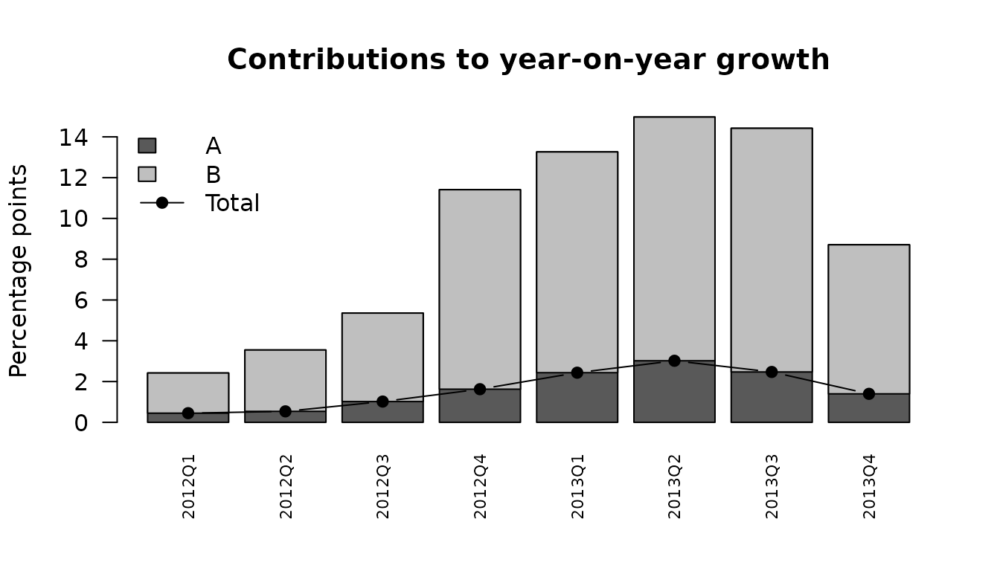

# Practical case: from current prices to published contributions

``` r

library(chainlink)
```

This vignette follows a complete workflow, from raw quarterly data to
the series that are usually published: chain-linked volume series,
growth rates and contributions to growth. It does not require to know
the examples of the IMF manual (see the vignette `imf_qna_manual` for
them).

The data are those of the example 8.2 of the manual: two products, `A`
and `B`, with their current prices and their price indices over the
previous year (2010 is the reference year).

## 1. Prepare the inputs

The functions use `ts` objects. Raw data usually come as a table, with
one row per quarter:

``` r

raw <- data.frame(
    year = rep(2010:2013, each = 4),
    quarter = rep(1:4, times = 4),
    A_cp = as.numeric(imf_cp[, "A"]),
    B_cp = as.numeric(imf_cp[, "B"]),
    A_pi = as.numeric(imf_pi[, "A"]),
    B_pi = as.numeric(imf_pi[, "B"])
)
head(raw, 6)
#>   year quarter  A_cp  B_cp  A_pi B_pi
#> 1 2010       1 150.0 225.0    NA   NA
#> 2 2010       2 150.0 225.0    NA   NA
#> 3 2010       3 150.0 225.0    NA   NA
#> 4 2010       4 150.0 225.0    NA   NA
#> 5 2011       1 159.7 218.9 102.0   99
#> 6 2011       2 163.2 213.7 102.5   98
```

``` r

to_ts <- function(df, columns, names) {
    res <- ts(as.matrix(df[, columns]),
              start = c(df$year[1], df$quarter[1]), frequency = 4)
    colnames(res) <- names
    res
}
cp <- to_ts(raw, c("A_cp", "B_cp"), c("A", "B"))
price_idx <- to_ts(raw, c("A_pi", "B_pi"), c("A", "B"))
```

What the functions expect:

- `cp`: current prices of the components, without the total. They must
  cover the reference year (2010 here), whose annual sum gives the level
  of the chain measures;
- `price_idx`: price indices over the previous year (average of the
  previous year = 100). They are not needed in the reference year (here
  they are missing in 2010).

``` r

window(price_idx, end = c(2011, 2))
#>             A  B
#> 2010 Q1    NA NA
#> 2010 Q2    NA NA
#> 2010 Q3    NA NA
#> 2010 Q4    NA NA
#> 2011 Q1 102.0 99
#> 2011 Q2 102.5 98
```

If the price indices are given over the previous quarter (or month)
instead, the quarter-to-quarter indices of
[`fisher()`](https://aqlt.github.io/chainlink/reference/fixed_weight_indices.md)
or
[`laspeyres()`](https://aqlt.github.io/chainlink/reference/fixed_weight_indices.md)
need `reference_freq = 4`, and
[`pi_py2pp()`](https://aqlt.github.io/chainlink/reference/pi_py2pp.md)
converts price indices over the previous year to indices over the
previous quarter.

## 2. Chain-linked volume series

With the annual overlap technique and 2010 as reference year, the
chain-linked Laspeyres-type volume measures (in monetary terms) of the
products and of their total are:

``` r

x <- chain_laspeyres(cp, price_idx, method = "ao", base_year = 2010,
                     output = "measure")
round(x, 1)
#>             A     B Total
#> 2011 Q1 156.6 221.1 377.7
#> 2011 Q2 159.2 218.1 377.3
#> 2011 Q3 162.5 214.9 377.4
#> 2011 Q4 164.8 213.8 378.6
#> 2012 Q1 165.6 213.6 379.4
#> 2012 Q2 172.3 206.5 379.3
#> 2012 Q3 182.2 198.2 381.3
#> 2012 Q4 206.9 176.1 384.8
#> 2013 Q1 214.2 171.4 388.6
#> 2013 Q2 227.0 159.8 390.8
#> 2013 Q3 235.0 151.0 390.7
#> 2013 Q4 238.6 146.6 390.1
```

The last column is the total. Chain volume measures are not additive:
the total differs from the sum of the products, except in 2010 and 2011.

``` r

chain_discrepancy(x) |> round(2)
#>       Qtr1  Qtr2  Qtr3  Qtr4
#> 2011  0.00  0.00  0.00  0.00
#> 2012 -0.17 -0.46 -0.84 -1.81
#> 2013 -3.08 -4.00 -4.63 -4.93
```

The same series as indices (2010 = 100):

``` r

idx <- chain_laspeyres(cp, price_idx, method = "ao", base_year = 2010,
                       output = "index")
round(idx, 2)
#>              A     B  Total
#> 2011 Q1 104.38 98.27 100.71
#> 2011 Q2 106.15 96.92 100.61
#> 2011 Q3 108.35 95.51 100.65
#> 2011 Q4 109.84 95.04 100.96
#> 2012 Q1 110.39 94.94 101.17
#> 2012 Q2 114.88 91.79 101.15
#> 2012 Q3 121.49 88.09 101.67
#> 2012 Q4 137.91 78.25 102.60
#> 2013 Q1 142.77 76.17 103.63
#> 2013 Q2 151.33 71.01 104.20
#> 2013 Q3 156.68 67.13 104.18
#> 2013 Q4 159.09 65.14 104.03
```

## 3. Growth rates and contributions

Growth rates of the total, over the previous quarter and over the same
quarter of the previous year:

``` r

growth_qoq <- 100 * (x[, "Total"] / stats::lag(x[, "Total"], -1) - 1)
growth_yoy <- 100 * (x[, "Total"] / stats::lag(x[, "Total"], -4) - 1)
round(ts.union(`Quarter-to-quarter` = growth_qoq, `Year-on-year` = growth_yoy), 2)
#>         Quarter-to-quarter Year-on-year
#> 2011 Q2              -0.11           NA
#> 2011 Q3               0.04           NA
#> 2011 Q4               0.31           NA
#> 2012 Q1               0.21         0.45
#> 2012 Q2              -0.02         0.54
#> 2012 Q3               0.52         1.02
#> 2012 Q4               0.91         1.63
#> 2013 Q1               1.00         2.43
#> 2013 Q2               0.55         3.02
#> 2013 Q3              -0.02         2.47
#> 2013 Q4              -0.14         1.40
```

Contributions of the products to these growth rates.
[`chain_contrib()`](https://aqlt.github.io/chainlink/reference/chain_contrib.md)
takes the output of
[`chain_laspeyres()`](https://aqlt.github.io/chainlink/reference/chain_laspeyres.md)
and the current prices of the components; `extra` adds the growth of the
total and the residual (growth minus the sum of the contributions):

``` r

contrib_qoq <- chain_contrib(x, cp, method = "ao", type = "period",
                             extra = c("total", "residual"))
contrib_yoy <- chain_contrib(x, cp, method = "ao", type = "yoy",
                             extra = c("total", "residual"))
round(contrib_qoq, 3)
#>             A      B  Total Residual
#> 2011 Q1    NA     NA     NA       NA
#> 2011 Q2 0.702 -0.808 -0.106        0
#> 2011 Q3 0.876 -0.838  0.038        0
#> 2011 Q4 0.592 -0.281  0.311        0
#> 2012 Q1 0.248 -0.041  0.207        0
#> 2012 Q2 1.817 -1.835 -0.017        0
#> 2012 Q3 2.673 -2.158  0.516        0
#> 2012 Q4 6.615 -5.701  0.913        0
#> 2013 Q1 2.082 -1.077  1.005        0
#> 2013 Q2 3.440 -2.887  0.553        0
#> 2013 Q3 2.136 -2.156 -0.020        0
#> 2013 Q4 0.966 -1.109 -0.143        0
round(contrib_yoy, 3)
#>              A       B Total Residual
#> 2011 Q1     NA      NA    NA       NA
#> 2011 Q2     NA      NA    NA       NA
#> 2011 Q3     NA      NA    NA       NA
#> 2011 Q4     NA      NA    NA       NA
#> 2012 Q1  2.419  -1.970 0.450        0
#> 2012 Q2  3.548  -3.009 0.539        0
#> 2012 Q3  5.357  -4.338 1.019        0
#> 2012 Q4 11.409  -9.783 1.626        0
#> 2013 Q1 13.261 -10.826 2.435        0
#> 2013 Q2 14.971 -11.951 3.020        0
#> 2013 Q3 14.419 -11.949 2.471        0
#> 2013 Q4  8.707  -7.310 1.398        0
```

The residual is zero if the data are fully consistent. Here it is not
exactly zero (the annual price indices of the example are not exactly
consistent with the quarterly data) but it is negligible: it must be
reported rather than allocated.

``` r

max(abs(contrib_qoq[, "Residual"]), na.rm = TRUE)
#> [1] 3.730349e-14
max(abs(contrib_yoy[, "Residual"]), na.rm = TRUE)
#> [1] 4.52971e-14
```

## 4. A chart for the publication

Stacked contributions and growth of the total (year-on-year):

``` r

plot_contributions <- function(contrib, main) {
    comp <- as.matrix(contrib[, c("A", "B")])
    growth <- as.numeric(contrib[, "Total"])
    labels <- paste0(floor(time(contrib)), "Q", cycle(contrib))
    keep <- !is.na(comp[, 1])
    bp <- barplot(t(comp[keep, ]), names.arg = labels[keep],
                  col = c("grey35", "grey75"), las = 2, cex.names = 0.7,
                  ylab = "Percentage points", main = main)
    lines(bp, growth[keep], type = "b", pch = 19)
    legend("topleft", legend = c("A", "B", "Total"),
           fill = c("grey35", "grey75", NA), border = c("black", "black", NA),
           pch = c(NA, NA, 19), lty = c(NA, NA, 1), bty = "n")
}
plot_contributions(contrib_yoy, "Contributions to year-on-year growth")
```



## 5. Annual series and change of the reference year

Contributions to the growth of the annual sums:

``` r

chain_contrib(x, cp, method = "ao", type = "annual", extra = "total") |>
    round(3)
#> Time Series:
#> Start = 2011 
#> End = 2013 
#> Frequency = 1 
#>           A       B Total
#> 2011  2.871  -2.139 0.732
#> 2012  5.687  -4.779 0.909
#> 2013 12.827 -10.499 2.328
```

Indices are often published with a recent reference year.
[`chain_rebase()`](https://aqlt.github.io/chainlink/reference/chain_rebase.md)
changes it (the average of the new year is 100) without changing the
growth rates:

``` r

chain_rebase(idx, base_year = 2012) |> round(2)
#>              A      B  Total
#> 2011 Q1  86.14 111.33  99.08
#> 2011 Q2  87.60 109.80  98.98
#> 2011 Q3  89.42 108.20  99.01
#> 2011 Q4  90.65 107.67  99.32
#> 2012 Q1  91.11 107.56  99.53
#> 2012 Q2  94.81 103.99  99.51
#> 2012 Q3 100.26  99.80 100.02
#> 2012 Q4 113.82  88.66 100.94
#> 2013 Q1 117.83  86.29 101.95
#> 2013 Q2 124.89  80.44 102.52
#> 2013 Q3 129.30  76.05 102.49
#> 2013 Q4 131.30  73.79 102.35
```

The contributions must be computed from the measures built with their
original reference year (here 2010), before rebasing.

## 6. One-quarter overlap and benchmarking

With the one-quarter overlap technique, the quarterly series are linked
on the last quarter of the year, so that the annual sums of the chain
volume measures differ from those of the annual chain series (annual
overlap). They can be benchmarked on them with the `tempdisagg` package
(Denton, Cholette’s variant), as in the vignette `imf_qna_manual`.

``` r

x_oqo <- chain_laspeyres(cp, price_idx, method = "oqo", base_year = 2010,
                         output = "measure")
contrib_oqo <- chain_contrib(x_oqo, cp, method = "oqo", type = "yoy", pi = price_idx,
                             extra = c("total", "residual"))
round(contrib_oqo, 3)
#>              A       B Total Residual
#> 2011 Q1     NA      NA    NA       NA
#> 2011 Q2     NA      NA    NA       NA
#> 2011 Q3     NA      NA    NA       NA
#> 2011 Q4     NA      NA    NA       NA
#> 2012 Q1  2.397  -1.986 0.410        0
#> 2012 Q2  3.524  -3.025 0.499        0
#> 2012 Q3  5.333  -4.353 0.979        0
#> 2012 Q4 11.382  -9.796 1.586        0
#> 2013 Q1 13.147 -10.928 2.219        0
#> 2013 Q2 14.849 -12.047 2.803        0
#> 2013 Q3 14.294 -12.039 2.255        0
#> 2013 Q4  8.581  -7.397 1.184        0
```

``` r

annual_ao <- aggregate(x[, "Total"], FUN = sum)
x_oqo_total <- x_oqo[, "Total"]
bench <- tempdisagg::td(annual_ao ~ 0 + x_oqo_total,
                        conversion = "sum", method = "denton-cholette")
x_oqo_bench <- predict(bench)
ts.union(`One-quarter overlap` = x_oqo_total,
         `Benchmarked` = x_oqo_bench) |> round(1)
#>         One-quarter overlap Benchmarked
#> 2011 Q1               377.7       377.7
#> 2011 Q2               377.3       377.3
#> 2011 Q3               377.4       377.4
#> 2011 Q4               378.6       378.6
#> 2012 Q1               379.2       379.2
#> 2012 Q2               379.2       379.2
#> 2012 Q3               381.1       381.3
#> 2012 Q4               384.6       385.0
#> 2013 Q1               387.6       388.4
#> 2013 Q2               389.8       390.7
#> 2013 Q3               389.7       390.8
#> 2013 Q4               389.2       390.3
```

The contributions above are those of the non-benchmarked one-quarter
overlap series: benchmarking the total alone breaks the link between the
total and its components, so the contributions of the benchmarked series
are not available through
[`chain_contrib()`](https://aqlt.github.io/chainlink/reference/chain_contrib.md).

## 7. Seasonal adjustment of chain-linked series

Chain-linked volume series are often seasonally adjusted. The ESS
Guidelines on Seasonal Adjustment (item 5.6) describe how to derive the
seasonally adjusted aggregate of annually chain-linked Laspeyres-type
components **indirectly**, that is by aggregating the seasonally
adjusted components:

1.  seasonally adjust the chain volume measures of the components;
2.  un-chain them
    ([`chain_unchain()`](https://aqlt.github.io/chainlink/reference/chain_unchain.md)):
    the volume at the prices of the previous year is additive within
    each year;
3.  aggregate them and chain-link the aggregate again, with the same
    technique;
4.  re-reference it to the reference year (the annual current prices of
    the reference year are those of the unadjusted data).

[`chain_aggregate()`](https://aqlt.github.io/chainlink/reference/chain_unchain.md)
does the steps 2 to 4. Here the seasonal adjustment is an illustration
with [`stats::stl()`](https://rdrr.io/r/stats/stl.html) (the data of the
example only have 12 quarters and no real seasonality, so that the
adjustment is not meaningful in itself):

``` r

sa_stl <- function(s) {
    fit <- stats::stl(s, s.window = "periodic")
    fit$time.series[, "trend"] + fit$time.series[, "remainder"]
}
# Step 1: seasonally adjusted chain volume measures of the components
x_sa <- ts.union(A = sa_stl(x[, "A"]), B = sa_stl(x[, "B"]))
round(x_sa, 1)
#>             A     B
#> 2011 Q1 160.3 217.0
#> 2011 Q2 160.3 217.0
#> 2011 Q3 162.0 215.7
#> 2011 Q4 160.5 218.2
#> 2012 Q1 169.3 209.5
#> 2012 Q2 173.4 205.4
#> 2012 Q3 181.7 199.0
#> 2012 Q4 202.6 180.4
#> 2013 Q1 217.9 167.3
#> 2013 Q2 228.1 158.7
#> 2013 Q3 234.5 151.9
#> 2013 Q4 234.4 150.9
```

Step 2: un-chained components, i.e. volumes at the prices of the
previous year, that can be summed:

``` r

chain_unchain(x_sa, cp, base_year = 2010) |> round(1)
#>             A     B
#> 2011 Q1 160.3 217.0
#> 2011 Q2 160.3 217.0
#> 2011 Q3 162.0 215.7
#> 2011 Q4 160.5 218.2
#> 2012 Q1 173.8 206.4
#> 2012 Q2 178.0 202.4
#> 2012 Q3 186.5 196.0
#> 2012 Q4 207.9 177.7
#> 2013 Q1 227.5 162.1
#> 2013 Q2 238.1 153.7
#> 2013 Q3 244.8 147.1
#> 2013 Q4 244.7 146.2
```

Steps 3 and 4: the indirectly seasonally adjusted aggregate, compared to
the direct adjustment of the aggregate and to the unadjusted data:

``` r

indirect <- chain_aggregate(x_sa, cp, base_year = 2010, output = "measure")
direct <- sa_stl(x[, "Total"])
sa <- ts.union(Unadjusted = x[, "Total"], `SA direct` = direct,
               `SA indirect` = indirect)
round(sa, 1)
#>         Unadjusted SA direct SA indirect
#> 2011 Q1      377.7     377.4       377.3
#> 2011 Q2      377.3     377.3       377.3
#> 2011 Q3      377.4     377.7       377.7
#> 2011 Q4      378.6     378.7       378.7
#> 2012 Q1      379.4     379.1       379.2
#> 2012 Q2      379.3     379.3       379.4
#> 2012 Q3      381.3     381.5       381.5
#> 2012 Q4      384.8     384.8       384.6
#> 2013 Q1      388.6     388.3       388.6
#> 2013 Q2      390.8     390.7       390.9
#> 2013 Q3      390.7     390.9       390.9
#> 2013 Q4      390.1     390.2       389.9
```

The two approaches give different seasonally adjusted aggregates. The
annual totals of the seasonally adjusted series are not forced to be
those of the unadjusted data:

``` r

aggregate(sa, FUN = sum) |> round(1)
#> Time Series:
#> Start = 2011 
#> End = 2013 
#> Frequency = 1 
#>      Unadjusted SA direct SA indirect
#> 2011     1511.0    1511.0      1511.0
#> 2012     1524.7    1524.7      1524.7
#> 2013     1560.2    1560.2      1560.2
```

If users require it and if the unadjusted data are additive, the
guidelines suggest forcing the annual totals (for instance with the
Denton method of the `tempdisagg` package, as in the vignette on the
manual). The indirect approach only exists for Laspeyres-type series:
for the other chain-linked indices, only the direct approach is
feasible. With the one-quarter overlap technique, use `method = "oqo"`
and the price indices `pi` (the overlap quarter is valued at the average
prices of the year).
